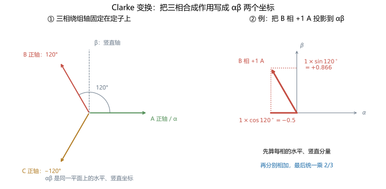
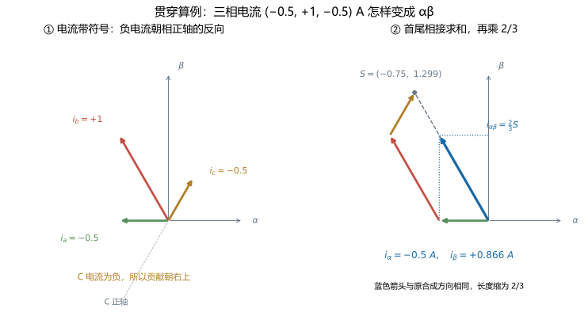
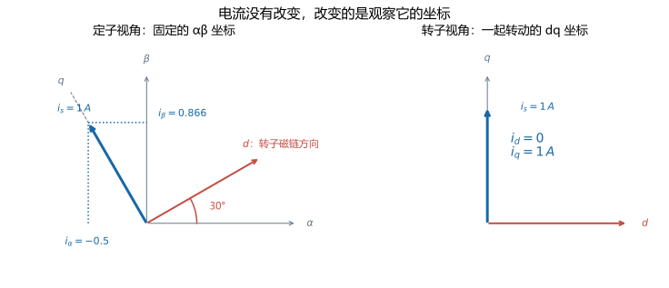
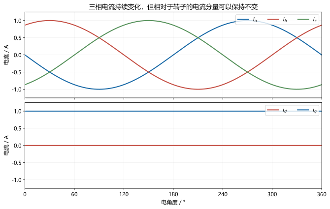
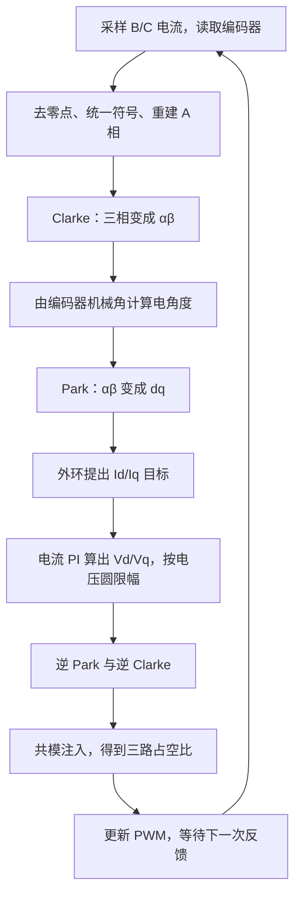
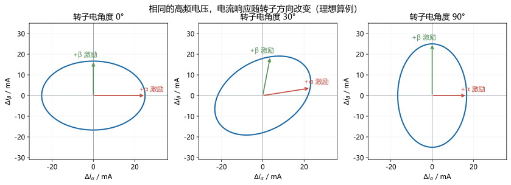
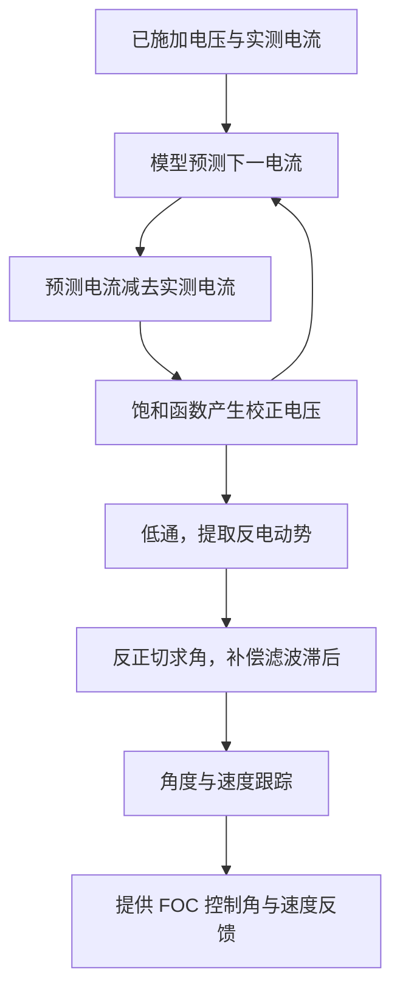
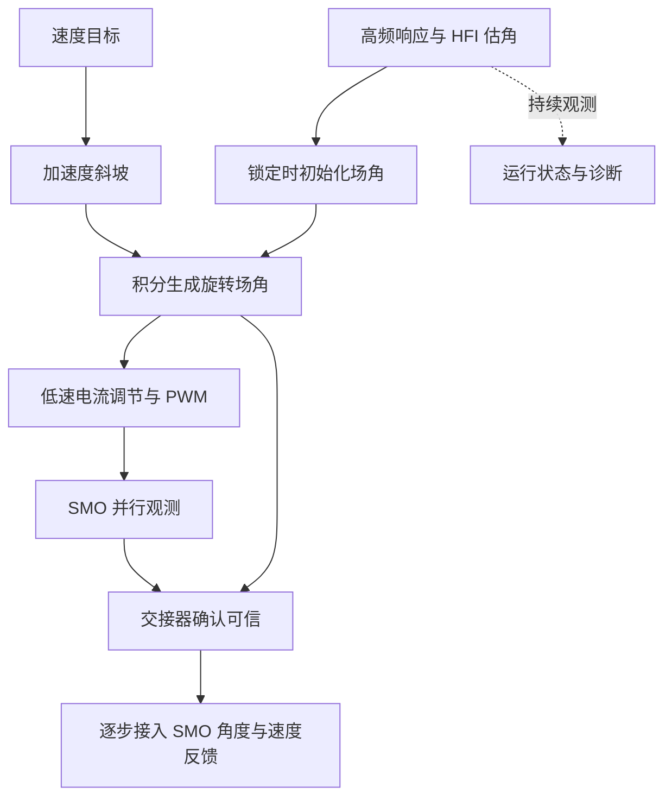
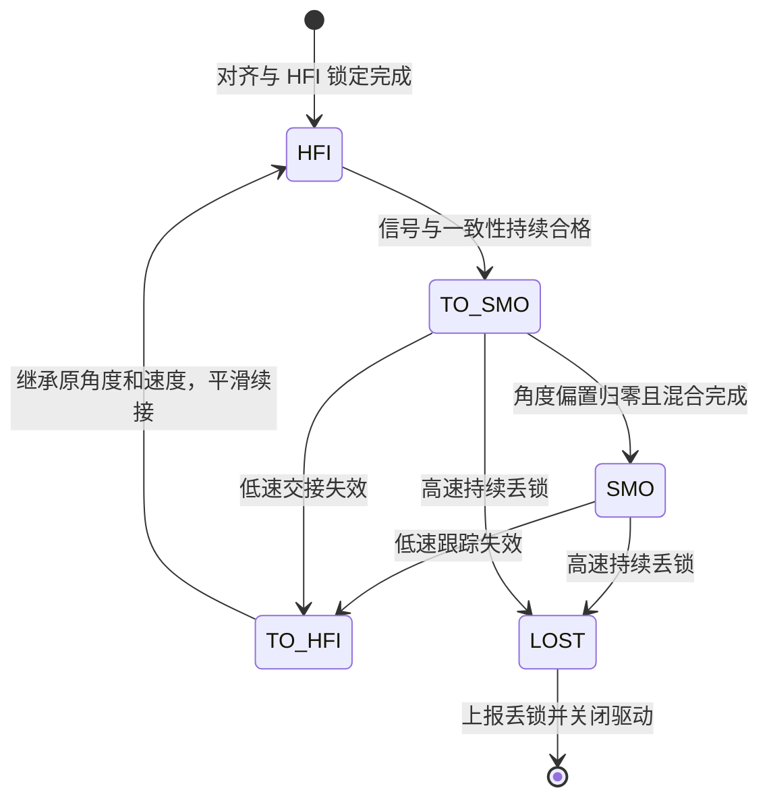

# FOC 入门到无感控制：以 CW32L010 项目为例

## 怎样阅读这份教材

这份教材想回答一个连续的问题：**给电机一个转速目标以后，软件究竟怎样算出三路 PWM？如果不读取转子位置传感器，又怎样完成同一件事？**

我们从电流和磁场讲起，每次只引入完成下一步所必需的概念。先把有感 FOC 的完整链条走通，再讨论 HFI 和 SMO。正文使用普通物理单位，代码中的定点缩放与执行时序放到另一本 [FOC 计算与时序实现](foc-implementation.md)。

阅读时不要求先掌握复数、控制理论或矩阵运算。需要用到的三角投影、导数、积分会在出现时解释。带有“进阶阅读”的部分可以先跳过；它们保留更严格的推导，供第二遍阅读。

全文区分两类数字：

- **项目配置**：来自当前代码，例如七极对、12 V 默认母线、3.7 Ω 模型电阻。
- **教学算例**：为了手算而选取的数字，例如某一时刻转子电角度为 30°。它们不表示已实测得到这台电机的全部参数。

### 学习路线

| 阶段 | 章节 | 学完以后应能回答 |
| --- | --- | --- |
| 建立直觉 | 第 1～2 章 | 电流为什么能产生转矩，电角度是什么 |
| 学会描述电流 | 第 3～4 章 | 三相电流怎样变成 d/q 电流 |
| 学会调节电流 | 第 5～7 章 | 电流为什么需要 PI，速度目标怎样变成电流目标 |
| 完成有感控制 | 第 8～9 章 | 电压怎样变成 PWM，编码器怎样接进闭环 |
| 理解无感 | 第 10～12 章 | HFI 和 SMO 分别从哪里获得位置信息 |
| 连成实际系统 | 第 13～15 章 | 怎样交接、反转、弱磁，以及项目实际实现到哪一步 |

建议第一遍顺序阅读到第 9 章，自己复算其中的 30° 算例；第二遍再读无感部分。不要一开始就背变换矩阵。

## 第 1 章　先弄清楚：FOC 到底在控制什么

### 1.1 电机为什么会转

这台电机的转子上有永磁体，定子上有三相绕组。绕组流过电流后会产生磁场，定子磁场与转子磁场相互作用，产生使转子转动的力矩，简称**转矩**。

从控制的角度看，有两件事可以调整：定子磁场有多强，以及它朝哪个方向。绕组电流决定这两件事。电压只是促使电流建立和变化的手段。

可以先用“沿着转子磁场”和“垂直于转子磁场”来分解电流的作用：

- 沿着转子磁场的部分，主要改变合成磁链。
- 垂直于转子磁场的部分，主要产生转矩。

这两部分以后分别叫 **d 轴电流**和 **q 轴电流**。在本项目采用的近似表贴式永磁同步电机模型中，常规运行通常希望 d 轴电流接近零，用 q 轴电流控制转矩。

这里的“方向”是三相绕组共同作用后形成的磁场方向，不是说某一根导线必须在空间中转动。

### 1.2 为什么不能只给三个固定电压

如果定子磁场方向一直不动，转子一般会被吸到某个方向，随后停在那里。要持续转动，定子磁场也要沿合适的方向转动。

如果只让定子磁场按预定速度转，而不管转子能不能跟上，轻载时可能正常，负载变大时就可能失步。FOC 希望始终知道转子磁场在哪里，并相对于它调节电流。

所以，FOC 每次都在重复以下过程：

```text
知道转子朝向
  → 判断当前电流中，多少在励磁、多少在产生转矩
  → 与希望的电流比较
  → 调整电压，使下一时刻的电流更接近目标
```

### 1.3 FOC、PWM、速度控制分别是什么

这三个名字处在不同层次：

| 名称 | 它解决的问题 |
| --- | --- |
| FOC，磁场定向控制 | 相对于转子方向，把电流分成励磁与转矩分量并调节 |
| PWM，脉宽调制 | 用开关的导通比例实现所需平均电压 |
| 速度控制 | 根据转速误差，决定需要多大的转矩电流 |

因此，三路 PWM 是执行手段，FOC 是电流控制方法，速度环是 FOC 外面的一层控制。输出了三相正弦波，并不自动意味着速度已经闭环。

**本章应理解：FOC 最直接调节的是相对于转子的电流。转速目标要经过外环，最终也会变成电流需求。**

## 第 2 章　角度、极对数，以及后面会用到的一点数学

### 2.1 机械角与电角度

机械角就是电机轴实际转过的角度。电角度描述转子磁场相对于定子绕组的周期位置。

如果转子只有一对磁极，机械转一圈，磁场关系也重复一圈。如果有七对磁极，机械转一圈，同样的磁场关系会重复七次。

因此：

$$
\theta_e=p\theta_m-\theta_0.
$$

逐个解释符号：$\theta_m$ 是机械角，$\theta_e$ 是电角度，$p$ 是极对数，$\theta_0$ 是传感器安装和对齐产生的零点偏差。每过一整圈，可以减去 $2\pi$，因为方向又回到了同一个位置。

**项目配置：**本电机取 $p=7$。如果机械轴转过 10°，电角度就前进 70°。Park 变换要用电角度，CLI 中的 rad/s 指的是机械速度。

### 2.2 度、弧度、rad/s 与 rpm

一圈是 360°，也是 $2\pi$ rad。因此：

$$
180^\circ=\pi\ \mathrm{rad},\qquad
n_{rpm}=\omega_m\frac{60}{2\pi}.
$$

例如 400 rad/s 对应约 3820 rpm。七极对时，电角速度是 $7\times400=2800$ rad/s，电气频率约为 $2800/(2\pi)=446$ Hz。

后面的公式默认角度使用弧度；算三角函数时，30° 与 $\pi/6$ 表示同一个方向。

### 2.3 导数：这一刻变化有多快

速度就是角度的变化率：

$$
\omega=\frac{d\theta}{dt}.
$$

符号 $d\theta/dt$ 可以先理解为“很短时间内，角度变化除以时间”。程序只能离散采样，通常近似为：

$$
\omega[k]\approx\frac{\theta[k]-\theta[k-1]}{T_s}.
$$

$k$ 是当前第几次计算，$T_s$ 是两次计算之间的时间。例如 1 ms 内前进 0.01 rad，速度约为 10 rad/s。

### 2.4 积分：把每一小段变化累加起来

如果知道速度，就能用它推进角度：

$$
\theta[k+1]\approx\theta[k]+\omega[k]T_s.
$$

这就是后面“积分生成旋转场”“根据估计速度预测下一角度”的意思。积分不一定是复杂运算，在程序里经常就是不断累加小增量。

### 2.5 磁链是什么

磁通可以理解为穿过一个线圈面的磁场总量；线圈有多匝时，把各匝链接的磁通相加，就是磁链。简单均匀情况下可写 $\lambda=N\Phi$，其中 $N$ 是匝数。

磁链改变会产生感应电压。转子永磁体即使磁性没有变，它相对于定子绕组转动时，绕组所链接的磁通也在变，因此产生反电动势。

**本章应理解：速度是角度变化率，积分能用速度推进角度；极对数把机械运动与磁场周期联系起来。**

## 第 3 章　把三相电流画成一根箭头：Clarke 变换

### 3.1 为什么需要一根“电流箭头”

三个电流 $i_a,i_b,i_c$ 同时变化，不容易直接看出它们合成的磁场朝哪里。因为三组绕组在空间里相差 120°，可以把各相的作用按绕组方向画成箭头，再相加。

我们用 $\alpha$ 表示固定在定子上的水平轴，用 $\beta$ 表示竖直轴。**电流矢量**就是这样一根箭头：横坐标为 $i_\alpha$，纵坐标为 $i_\beta$。它是描述三相合成作用的数学表示。



图 3-1：左边是三条相差 120° 的绕组正轴，$\alpha$ 与 A 相正轴重合，$\beta$ 与它垂直。右边单独取 B 相 +1 A：它指向左上，因此水平投影为负，竖直投影为正。这里画的是该相的原始贡献，尚未乘 $2/3$。

三相作用可以在**同一个平面**内相加，不需要想成从三维空间压扁到二维。$\alpha\beta$ 也固定在定子上，没有跟着转子转；下一章的 Park 变换才会引入随转子旋转的坐标。

### 3.2 先用三角投影求和

规定 A 相方向为 0°，B 相方向为 120°，C 相方向为 −120°。每相在水平轴上的作用为：

$$
i_a\cos0^\circ=i_a,\quad
i_b\cos120^\circ=-\frac{i_b}{2},\quad
i_c\cos(-120^\circ)=-\frac{i_c}{2}.
$$

在竖直轴上则是：

$$
0,\qquad \frac{\sqrt3}{2}i_b,\qquad-\frac{\sqrt3}{2}i_c.
$$

把这些投影相加，再乘一个统一的归一化系数 $2/3$，定义：

$$
i_\alpha=\frac23\left(i_a-\frac{i_b}{2}-\frac{i_c}{2}\right),\qquad
i_\beta=\frac23\frac{\sqrt3}{2}(i_b-i_c).
$$

这里乘 $2/3$，是为了让平衡三相正弦电流的峰值，与合成电流箭头的长度一致。这种选择称为**幅值不变变换**。它是尺度约定，不是凭空多出或少了电流。

### 3.3 为什么最后只需要两个电流

这类没有中性线电流的三相系统满足：

$$
i_a+i_b+i_c=0.
$$

于是 $i_c=-i_a-i_b$。把它代入上一节，逐项合并即可得到：

$$
\boxed{i_\alpha=i_a,\qquad i_\beta=\frac{i_a+2i_b}{\sqrt3}}.
$$

这组公式叫 Clarke 变换。它把三相的描述，变成定子平面内的两个坐标，并没有丢掉平衡三相系统的有效信息。

### 3.4 贯穿算例，第一步：三相变成 αβ

**教学算例：**某一时刻读到：

$$
i_a=-0.5\ \mathrm A,\quad i_b=1\ \mathrm A,\quad i_c=-0.5\ \mathrm A.
$$



图 3-2：左图先按电流正负确定每相贡献的方向，右图把三根彩色箭头首尾相接。灰色虚线是尚未归一化的和，蓝色箭头是再乘 $2/3$ 后的最终电流矢量。

特别注意 C 相：它的正轴朝左下，但当前电流为 −0.5 A，所以这一相的贡献反而朝右上。按图分别累加投影，可得到：

| 相 | 电流 / A | 原始水平贡献 / A | 原始竖直贡献 / A |
| --- | --- | --- | --- |
| A | −0.5 | −0.5 | 0 |
| B | +1 | −0.5 | +0.866 |
| C | −0.5 | +0.25 | +0.433 |
| 合计，尚未乘 $2/3$ | | −0.75 | +1.299 |
| 乘 $2/3$ 后的 αβ | | **−0.5** | **+0.866** |

先检查三相和：$-0.5+1-0.5=0$。再计算：

$$
i_\alpha=-0.5\ \mathrm A,
$$

$$
i_\beta=\frac{-0.5+2\times1}{\sqrt3}
=\frac{1.5}{\sqrt3}\approx0.866\ \mathrm A.
$$

箭头长度为 $\sqrt{(-0.5)^2+0.866^2}\approx1$ A，方向为 120°。注意：这个 120° 是**电流箭头的方向**，还不是转子方向。

**停下来想一想：**若三相都变为原来的两倍，箭头朝向会不会变？答案见文末自测。

## 第 4 章　跟着转子看电流：Park 变换

### 4.1 固定坐标与转动坐标

上一章的 $\alpha\beta$ 坐标固定在定子上。现在想象把坐标纸转过去，让水平轴始终指向转子磁链，这条新水平轴就叫 d 轴；再逆时针转 90°，得到 q 轴。

电流箭头没有变化，只是用另一套坐标描述它。



图 4-1：转子电角度为 30°，电流箭头朝向 120°。相对于转子，它恰好沿 q 轴。

### 4.2 用投影推导，不必先背矩阵

若 d 轴相对于 $\alpha$ 轴转过 $\theta_e$，d 轴单位方向的两个分量是 $(\cos\theta_e,\sin\theta_e)$。一个箭头在某个单位方向上的投影，就是对应分量相乘再相加。因此：

$$
\boxed{i_d=i_\alpha\cos\theta_e+i_\beta\sin\theta_e}.
$$

q 轴超前 d 轴 90°，方向分量是 $(-\sin\theta_e,\cos\theta_e)$，于是：

$$
\boxed{i_q=-i_\alpha\sin\theta_e+i_\beta\cos\theta_e}.
$$

这两条投影公式就是 Park 变换。

### 4.3 贯穿算例，第二步：αβ 变成 dq

继续上一章的电流：$i_\alpha=-0.5$ A，$i_\beta=\sqrt3/2$ A。现在编码器告诉我们，转子电角度为 30°。

因为 $\cos30^\circ=\sqrt3/2$、$\sin30^\circ=1/2$：

$$
i_d=-\frac12\frac{\sqrt3}{2}+\frac{\sqrt3}{2}\frac12=0,
$$

$$
i_q=-\left(-\frac12\right)\frac12+\frac{\sqrt3}{2}\frac{\sqrt3}{2}
=\frac14+\frac34=1\ \mathrm A.
$$

三个不断变化的电流，在这一时刻被解释为：没有 d 轴电流，有 1 A q 轴电流。这就把“电流有没有用在产生转矩上”变成了两个容易比较的数。

### 4.4 为什么三相交流可以变成直流量

如果电流箭头始终比转子磁链超前 90°，并且长度始终为 1 A，那么从定子看，它一直转；从跟着转子的坐标看，它一直向上。

| 转子电角度 | $i_a$ / A | $i_b$ / A | $i_c$ / A | $i_d$ / A | $i_q$ / A |
| --- | --- | --- | --- | --- | --- |
| 0° | 0 | 0.866 | −0.866 | 0 | 1 |
| 30° | −0.5 | 1 | −0.5 | 0 | 1 |
| 60° | −0.866 | 0.866 | 0 | 0 | 1 |
| 90° | −1 | 0.5 | 0.5 | 0 | 1 |



图 4-2：FOC 让电流调节器面对近似恒定的目标，不必直接追逐三条正弦曲线。

### 4.5 角度错了会怎样

若真实电流是 $i_d=0,i_q=1$ A，而程序用的坐标比转子超前 30°，程序将看到约 $\hat i_d=0.5$ A、$\hat i_q=0.866$ A。

反过来，程序按错误坐标建立“纯 q 轴电流”，在真实转子坐标中也会混入 d 轴分量。这就是估角误差为什么会影响电流、转矩和发热。

**本章应理解：Clarke 换一种方式描述三相合成作用；Park 再把这个描述旋转到转子坐标。两者本身都不改变真实电流。**

## 第 5 章　电压为什么能调节电流：先学单个线圈

### 5.1 电压被哪几部分用掉了

一个绕组至少具有电阻和电感。电阻需要电压来维持电流，电感使电流不能瞬间改变；电机转动时还会产生反电动势。

把某一个方向上的电压收支写出来：

$$
\boxed{v=Ri+L\frac{di}{dt}+e}.
$$

这里 $v$ 是施加电压，$Ri$ 是电阻压降，$L\,di/dt$ 是改变电流所需的电压，$e$ 是反电动势。移项以后：

$$
\boxed{\frac{di}{dt}=\frac{v-Ri-e}{L}}.
$$

现在可以直接判断：$v$ 比 $Ri+e$ 大，电流就上升；比它小，电流就下降；刚好相等，电流暂时不变。

### 5.2 手算一个电流上升的瞬间

取 $R=3.7$ Ω、$L=1$ mH，当前电流为 0.5 A，暂时令反电动势为零，施加 3 V。

电阻已经用掉 $3.7\times0.5=1.85$ V，剩下 1.15 V 用来改变电流：

$$
\frac{di}{dt}=\frac{1.15}{0.001}=1150\ \mathrm{A/s}.
$$

如果只看接下来很短的 20 µs，按当前斜率近似，电流增加 $1150\times20\times10^{-6}=0.023$ A。它不是立刻跳到 $3/3.7$ A。

随着电流变大，$Ri$ 也变大，所以上升会逐渐放慢。精确的静止 R/L 阶跃响应为：

$$
i(t)=\frac vR+\left(i(0)-\frac vR\right)e^{-t/\tau},\qquad \tau=\frac LR.
$$

这里的 $\tau$ 叫电气时间常数。本例约为 270 µs。指数公式第一遍可以不推，但要看懂它描述的是逐渐靠近稳态，而不是瞬间到达。

### 5.3 反电动势为什么随转速增加

永磁体磁链在固定坐标中的投影可以写成：

$$
\psi_\alpha=\psi_f\cos\theta_e,\qquad
\psi_\beta=\psi_f\sin\theta_e.
$$

磁链对时间求导，利用 $d\theta_e/dt=\omega_e$，得到：

$$
\boxed{e_\alpha=-\omega_e\psi_f\sin\theta_e,\qquad
e_\beta=\omega_e\psi_f\cos\theta_e}.
$$

它包含两个重要信息：幅值与转速成正比，方向与转子角度有关。这也是后面 SMO 能估角的基础。

### 5.4 转到 dq 坐标后，为什么会多出几项

若电流相对于转子保持不变，它在定子眼里仍然转动。电感磁链跟着旋转，也需要电压来维持。因此，不能把单线圈公式分别套到 d、q 轴后就结束。

完整的常参数模型为：

$$
\boxed{v_d=Ri_d+L_d\frac{di_d}{dt}-\omega_e L_q i_q},
$$

$$
\boxed{v_q=Ri_q+L_q\frac{di_q}{dt}+\omega_e(L_d i_d+\psi_f)}.
$$

逐项阅读：

| 项 | 它的作用 |
| --- | --- |
| $Ri_d,Ri_q$ | 支付电阻压降 |
| $L_d\,di_d/dt,L_q\,di_q/dt$ | 改变相应电流 |
| $-\omega_eL_qi_q,\omega_eL_di_d$ | 电感磁链随坐标旋转带来的交叉耦合 |
| $\omega_e\psi_f$ | 永磁体转动产生的反电动势 |

$L_d,L_q$ 是两个方向上的电感。即使它们相等，旋转耦合项仍然存在。严格的坐标微分推导见附录 A。

### 5.5 q 轴电流怎样变成转矩

在这里采用的幅值不变变换下，电磁转矩为：

$$
T_e=\frac32p\left[\psi_f i_q+(L_d-L_q)i_di_q\right].
$$

若 $L_d\approx L_q$，第二项很小，便有：

$$
T_e\approx K_t i_q,\qquad K_t=\frac32p\psi_f.
$$

这说明速度环为什么可以输出一个 Iq 目标：想要更大转矩，就要求更大 q 轴电流。比例 $K_t$ 与电机磁链和极对数有关。

**本章应理解：电压负责改变电流，电流负责产生磁链和转矩；转得越快，反电动势通常越大，留给调节电流的电压裕量越小。**

## 第 6 章　让电流追上目标：PI 调节器

### 6.1 先定义误差和控制目标

设希望的 q 轴电流为 $i_q^*$，实际测量为 $i_q$。上标星号表示“目标值”，不是乘法。误差定义为：

$$
e_i=i_q^*-i_q.
$$

如果电流偏小，误差为正，通常应增加相应电压。若只按误差大小立即调整，就是比例控制：

$$
v_P=K_p e_i.
$$

比例控制反应直接，但当存在持续电阻压降和反电动势时，可能需要保留一个误差才能产生足够电压。积分项用于逐步补上这种持续需求。

### 6.2 积分项就是“误差还在，就继续补一点”

$$
x_I[k+1]=x_I[k]+K_iT_s e_i[k].
$$

总电压指令为：

$$
\boxed{v^*=v_{ff}+K_p e_i+x_I}.
$$

$x_I$ 是过去积累的补偿，$v_{ff}$ 是提前估算出的所需电压，称为前馈。前馈提供一个合理起点，PI 再修正估算与实际之间的差异。

### 6.3 一个 PI 更新算例

**教学算例：**令目标电流 0.7 A、实测 0.5 A，$K_p=0.5$ V/A，$K_i=30$ V/(A·s)，$T_s=1$ ms，原积分为零。用 $Ri^*$ 作前馈。

1. 误差为 $0.7-0.5=0.2$ A。
2. 比例项为 $0.5\times0.2=0.1$ V。
3. 积分本次增加 $30\times0.001\times0.2=0.006$ V。
4. 电阻前馈为 $3.7\times0.7=2.59$ V。
5. 本次未限幅电压约为 $2.59+0.1+0.006=2.696$ V。

下一时刻电流变化以后，要重新测量、重新计算，而不是一直保持本次误差不变。

### 6.4 为什么需要抗积分饱和

假设电机已经需要 8 V，但当前母线只能提供约 6.9 V。即使积分器继续积到 10 V，硬件也无法实现。等目标下降时，过大的积分又会使输出迟迟降不下来。

项目采用的办法是：先试算本次积分；如果输出已经超过上限，而且误差还在继续把它往同一个方向推，就撤销这次积分。

例如上限 6 V、比例项加前馈为 5.9 V、原积分 0.1 V，候选积分升到 0.12 V 后会要求 6.02 V。若误差仍为正，就保留原来的 0.1 V，而不是继续积。

### 6.5 两个电流轴共用一个电压预算

d、q 两个电压是同一个平面矢量的分量，因此不能各自独占完整的电压上限。必须满足：

$$
v_d^2+v_q^2\leq V_{lim}^2.
$$

当前代码先计算 d 轴输出，再给 q 轴分配：

$$
|v_q|\leq\sqrt{V_{lim}^2-v_d^2}.
$$

例如 $V_{lim}=5$ V、$v_d=3$ V，q 轴最多只能给 4 V。这是“3、4、5”直角三角形，不是再给 q 轴 5 V。

### 6.6 项目里的前馈做到哪一步

两个电流轴都有电阻压降前馈；有感电流模式额外加入与速度相关的 q 轴反电动势前馈。代码没有完整实现第 5 章所有交叉耦合项的前馈抵消，剩余需求由 PI 调节。

本章给出的秒制增益用于理解计算。源码以工程整数单位存储，不能把这些数直接当作 CLI 的整数协议字段；对应换算放在实现文档。

**本章应理解：比例看当前误差，积分累积持续误差，前馈先支付可估计的电压需求；所有输出都要服从硬件限幅。**

## 第 7 章　从转矩到转速：外面的速度环和位置环

### 7.1 转矩不是转速

同样的转矩，空载时可能加速，带负载时可能只是维持速度。机械方程可写成：

$$
J_m\frac{d\omega_m}{dt}=T_e-T_L-B\omega_m.
$$

$J_m$ 表示转动惯量，$T_L$ 表示负载转矩，$B\omega_m$ 表示一种近似的转速相关阻力。左边是“加速需要的转矩”，右边是驱动力矩减掉阻力矩。

### 7.2 速度环输出电流需求

速度环比较目标与实际速度：

$$
e_\omega=\omega_m^*-\omega_m.
$$

它也可以用 PI，只是输出不再是电压，而是电流：

$$
i_q^*=\operatorname{限幅}\left(K_{p\omega}e_\omega+x_{I\omega}\right).
$$

举一个只看比例部分的例子：目标 20 rad/s、实际 15 rad/s，若比例增益为 0.02 A/(rad/s)，本次会提出 0.1 A 的转矩电流需求。实际完整输出还包含积分和限幅。

速度环不知道三相 PWM 的每个细节，它依靠更里面的电流环实现这份需求。

### 7.3 位置环再生成速度目标

若希望轴转到某个角度，位置环先根据位置误差给出速度目标，速度环再给出电流目标：


每一层都在回答下一层需要什么。内层应当比外层反应更快，否则外层不断提出新需求，内层还没有实现旧需求，容易出现振荡。

项目的有感速度环与无感速度环是两套不同配置。它们使用不同的测速来源和更新周期，不能只因为都叫速度 PI，就把增益直接互换。

**本章应理解：电流主要决定转矩；速度由转矩、惯量和负载共同决定。所以需要速度反馈，而不是简单地把某个电流叫作某个转速。**

## 第 8 章　把算出的电压变成三路 PWM

### 8.1 逆 Park：把电压箭头转回定子坐标

调节器给出的是转子坐标中的 $v_d,v_q$，绕组却固定在定子上。必须把电压分量沿 d、q 轴投影回 $\alpha\beta$：

$$
v_\alpha=v_d\cos\theta_e-v_q\sin\theta_e,
$$

$$
v_\beta=v_d\sin\theta_e+v_q\cos\theta_e.
$$

这叫逆 Park。它与第 4 章的 Park 变换方向相反。

### 8.2 逆 Clarke：从平面坐标回到三相参考

$$
u_a=v_\alpha,\qquad
u_b=-\frac12v_\alpha+\frac{\sqrt3}{2}v_\beta,\qquad
u_c=-\frac12v_\alpha-\frac{\sqrt3}{2}v_\beta.
$$

$u_a,u_b,u_c$ 是希望施加到绕组的三相平均电压参考。它们可能为负，而单个桥臂只能在母线正端与负端之间切换，怎么办？

### 8.3 共模电压：三相一起抬高，不改变相间差值

若三相都加 5 V，A、B 两相之间的差仍然是：

$$
(u_a+5)-(u_b+5)=u_a-u_b.
$$

电机中性点浮动时，可以利用这个自由度，把三相参考共同平移到硬件允许的范围。

令 $u_{max}$ 是三相最大值，$u_{min}$ 是最小值，母线为 $V_{dc}$。为了让最大、最小参考居中，选择：

$$
u_0=\frac{V_{dc}-u_{max}-u_{min}}2.
$$

三路占空比就是：

$$
d_a=\frac{u_a+u_0}{V_{dc}},\qquad
d_b=\frac{u_b+u_0}{V_{dc}},\qquad
d_c=\frac{u_c+u_0}{V_{dc}}.
$$

代码使用这种 min/max 共模注入，在平均电压意义上实现居中的空间矢量调制。SVPWM 是空间矢量脉宽调制的缩写。

### 8.4 贯穿算例，第三步：算出占空比

继续使用 30° 电角度。假设电流调节器这次给出 $v_d=0$ V、$v_q=2$ V，母线为 12 V。

逆 Park：

$$
v_\alpha=-2\sin30^\circ=-1\ \mathrm V,\qquad
v_\beta=2\cos30^\circ=\sqrt3\ \mathrm V.
$$

逆 Clarke：

$$
(u_a,u_b,u_c)=(-1,2,-1)\ \mathrm V.
$$

最大值 2 V，最小值 −1 V，所以：

$$
u_0=\frac{12-2-(-1)}2=5.5\ \mathrm V.
$$

桥臂平均电压变为 $(4.5,7.5,4.5)$ V，最终得到：

$$
\boxed{(d_a,d_b,d_c)=(37.5\%,62.5\%,37.5\%)}.
$$

三个桥臂都为正电压，但相对于共同的中性点，绕组仍能获得正负相电压。不要把桥臂对地电压与绕组相电压混为一谈。

### 8.5 为什么 12 V 母线的电压矢量上限约为 6.928 V

相差 120° 的两相正弦参考，其差值峰值是单相矢量幅值的 $\sqrt3$ 倍。要把三相共同平移到 $0\ldots V_{dc}$ 内，就要求：

$$
u_{max}-u_{min}\leq V_{dc}.
$$

为了在所有旋转方向都满足这个条件，选：

$$
\boxed{V_{lim}=\frac{V_{dc}}{\sqrt3}}.
$$

12 V 时约为 6.928 V。它是本文变换约定下的旋转电压矢量幅值上限，不是说桥臂对地只能输出 6.928 V。项目没有实现超出线性区的过调制算法。

**本章应理解：控制器算的是平均电压；PWM 用导通比例实现它，共模平移让所需相间电压适配有限的母线。**

## 第 9 章　把以上步骤接上编码器：有感 FOC

### 9.1 从硬件读数得到可信电流

项目实际采 B、C 两相，用 $i_a=-i_b-i_c$ 重建 A 相。上电零点并不一定恰好等于 ADC 中点，所以先关闭驱动，平均 100 组读数作为零点。

按 3.3 V ADC 参考、50 倍放大、10 mΩ 电阻，1 个 ADC 计数约对应 1.611 mA。当前板卡的符号约定是 ADC 读数下降对应正电流：

```c
ib = (zero_b - raw_b) * 6602 / 4096;
ic = (zero_c - raw_c) * 6602 / 4096;
ia = -ib - ic;
```

这些符号要与相序、编码器方向一起核对。某一路的正负号反了，可能使原本希望减小误差的动作反而增大误差。

### 9.2 编码器零点为什么还要对齐

编码器读到的是磁体安装角，并不天然知道电机 d 轴在哪。普通有感校准会施加固定方向电压，让转子趋向该方向，再记录电角度零点：

$$
\theta_0=p\theta_{m,align}.
$$

运行时使用 $\theta_e=p\theta_m-\theta_0$。项目普通校准默认施加 0.6 V、保持 500 ms。校准能否成立，依赖转子确实能够移动并完成对齐。

### 9.3 单圈编码器怎样用于连续测速

从 359° 读到 1°，通常是正向前进 2°，不是反向转了 358°。所以相邻读数差要按最短方向解回绕，再除以实际时间间隔。

项目先用 `ENCODER_DIRECTION=-1` 统一方向，然后对机械速度做一阶平滑：本次只吸收“原始速度与旧速度之差”的 $1/8$。这减少量化噪声，也带来延迟。

### 9.4 有感闭环全流程



现在回看第 3、4、8 章的贯穿算例，就能看到从电流测量到占空比的完整数字链条。下一次采样会检验这些占空比是否真的让电流向目标靠近。

**第一部分自检：如果遮住公式，你能否用自己的话解释“三相 → αβ → dq → 电流 PI → 电压 → 三相 PWM”？能解释以后，再进入无感部分。**

## 第 10 章　拿掉编码器以后，少了什么信息

### 10.1 FOC 核心并没有消失

无感 FOC 仍然要测电流、做 Park 变换、调节 d/q 电流并输出 PWM。少掉的是编码器直接提供的转子方向。

因此无感控制的任务是：从已施加的电压和已测得的电流中，推断转子朝向与速度。做这件事的算法叫**观测器**。所谓无感，通常指不依赖转子位置传感器作控制反馈，并不是不需要电流传感器。

### 10.2 为什么转起来以后相对容易

第 5 章已经得到：

$$
e_\alpha=-\omega_e\psi_f\sin\theta_e,\qquad
e_\beta=\omega_e\psi_f\cos\theta_e.
$$

反电动势的方向包含转子角度。电机转得足够快时，若能从电压、电流推算出这两个分量，就能估角。SMO 主要利用这条信息链。

### 10.3 为什么零速不能简单沿用同一个办法

当 $\omega_e=0$，上面两个反电动势分量都变成零。一个零长度箭头没有可用方向，再精确的反正切也无法从中获得转子位置。

如果电感在所有方向还完全相同，那么静止时给相同电压，转子不同方向产生的电流响应也一样。此时这些测量本身就不足以区分角度，这叫**不可观测或可观测性很弱**。

HFI 的办法是主动给电机一个高频的小激励，利用不同方向的增量电感差异观察转子。它不等着转子转动产生足够反电动势。

| 方法 | 类似于从什么线索判断方向 | 主要工作区域 |
| --- | --- | --- |
| 编码器 | 直接读取安装在轴上的方向标记 | 从静止到高速，受传感器自身限制 |
| HFI | 给一个已知激励，看不同方向响应快慢 | 零速、低速，但依赖可辨别的凸极信息 |
| SMO | 根据电压、电流还原运动产生的反电动势 | 有足够反电动势的中高速 |

**本章应理解：低速困难来自信息不足，而不只是计算精度不足。HFI 与 SMO 是在利用两种不同的信息源。**

## 第 11 章　HFI：给一个已知激励，看电流怎样响应

### 11.1 先理解“同样电压，电流变化快慢不同”

先忽略短时高频响应中的电阻和反电动势影响，单线圈模型近似为：

$$
\Delta i\approx\frac{V_h\Delta t}{L}.
$$

$V_h$ 是注入电压，$\Delta t$ 是很短的作用时间。电感越小，同样激励下电流变化越大。若转子某个方向上的增量电感不同，就能从这种差别判断方向。

这里的“增量电感”表示工作点附近的小信号响应。它可能来自几何结构，也可能来自磁饱和。不是所有电机在所有电流下都具有同样清晰的差异。

### 11.2 一个最简单的方向判断

**教学算例：**假设电机 d 轴高频增量电感为 0.8 mH，q 轴为 1.2 mH。先让 d 轴与固定的 $\alpha$ 轴重合。沿 $\alpha$ 施加 1 V、作用 20 µs：

$$
\Delta i_\alpha\approx\frac{1\times20\times10^{-6}}{0.8\times10^{-3}}
=25\ \mathrm{mA}.
$$

沿 $\beta$ 施加同样激励，变化量约为 16.7 mA。响应较大的轴对应较小电感的方向。这些电感和理想响应是教学数字，不是本项目电机的实测数据。



图 11-1：让激励方向绕一圈，电流变化箭头的端点形成一个椭圆。转子方向改变时，椭圆也跟着转；如果两个方向电感相等，椭圆退化成圆，就很难从方向差异估角。

### 11.3 转子不在坐标轴上时，响应为什么会偏斜

设转子电角度为 $\theta$。给固定坐标电压 $(v_\alpha,v_\beta)$，先按第 4 章的方法投影到 d/q 轴：

$$
v_d=v_\alpha\cos\theta+v_\beta\sin\theta,
$$

$$
v_q=-v_\alpha\sin\theta+v_\beta\cos\theta.
$$

两个方向各自按自己的电感建立电流变化率：

$$
\dot i_d=\frac{v_d}{L_d},\qquad \dot i_q=\frac{v_q}{L_q}.
$$

再旋转回固定坐标。把 $\dot i_d,\dot i_q$ 代入逆 Park，并把同类项放在一起：

$$
\dot i_\alpha=
\left(\frac{\cos^2\theta}{L_d}+\frac{\sin^2\theta}{L_q}\right)v_\alpha
+\left(\frac1{L_d}-\frac1{L_q}\right)\sin\theta\cos\theta\,v_\beta,
$$

$$
\dot i_\beta=
\left(\frac1{L_d}-\frac1{L_q}\right)\sin\theta\cos\theta\,v_\alpha
+\left(\frac{\sin^2\theta}{L_d}+\frac{\cos^2\theta}{L_q}\right)v_\beta.
$$

这两式告诉我们：即使只沿 $\alpha$ 加电压，也可能同时看到 $\alpha$ 和 $\beta$ 两个方向的电流变化。偏斜量本身就携带转子方向信息。

### 11.4 为什么公式中出现二倍角

使用三个三角恒等式：

$$
\cos^2\theta=\frac{1+\cos2\theta}{2},\quad
\sin^2\theta=\frac{1-\cos2\theta}{2},\quad
\sin\theta\cos\theta=\frac{\sin2\theta}{2}.
$$

定义平均部分与差异部分：

$$
\ell_0=\frac12\left(\frac1{L_d}+\frac1{L_q}\right),\qquad
\ell_2=\frac12\left(\frac1{L_d}-\frac1{L_q}\right).
$$

上一节四个系数就变为：

$$
C_{\alpha\alpha}=\ell_0+\ell_2\cos2\theta,\quad
C_{\beta\beta}=\ell_0-\ell_2\cos2\theta,
$$

$$
C_{\alpha\beta}=C_{\beta\alpha}=\ell_2\sin2\theta.
$$

这里 $C$ 只是“单位电压引起多大电流变化率”的系数。分别沿两个轴激励，就能测出这些系数的近似值。

相减消掉平均部分，相加提取交叉项：

$$
X=C_{\alpha\alpha}-C_{\beta\beta}=2\ell_2\cos2\theta,
$$

$$
Y=C_{\alpha\beta}+C_{\beta\alpha}=2\ell_2\sin2\theta.
$$

校准系数的比例与符号以后，$(X,Y)$ 的方向就是二倍转子角。因此：

$$
\boxed{\hat\theta=\frac12\operatorname{atan2}(Y,X)}.
$$

`atan2` 是根据横、纵两个分量求方向角的函数，能区分不同象限，比直接用 $\arctan(Y/X)$ 更完整。帽子 $\hat\theta$ 表示估计值。

### 11.5 完整手算一次 30° 估角

继续取 $L_d=0.8$ mH、$L_q=1.2$ mH，假设实际电角度为 30°。先算：

$$
\ell_0\approx1041.67\ \mathrm{H}^{-1},\qquad
\ell_2\approx208.33\ \mathrm{H}^{-1}.
$$

因为 $\cos60^\circ=0.5$、$\sin60^\circ\approx0.866$，得到：

$$
C_{\alpha\alpha}\approx1145.83,\quad
C_{\beta\beta}=937.50,\quad
C_{\alpha\beta}=C_{\beta\alpha}\approx180.42.
$$

单位均为 $\mathrm{H}^{-1}$。在理想的 1 V、20 µs 激励下，两次电流响应为：

| 激励方向 | $\Delta i_\alpha$ | $\Delta i_\beta$ |
| --- | --- | --- |
| 沿 $+\alpha$ | 22.917 mA | 3.608 mA |
| 沿 $+\beta$ | 3.608 mA | 18.750 mA |

由这些测量反推系数，再组合：

$$
X=1145.83-937.50=208.33,\qquad
Y=180.42+180.42=360.84.
$$

所以 $\operatorname{atan2}(360.84,208.33)\approx60^\circ$，再除以二，得到估角 30°。

这一遍计算的意义是：HFI 不是从一条电流曲线中“猜一个角度”，而是通过已知方向的激励，测出随方向变化的响应关系，再从关系中恢复角度。

### 11.6 为什么有 180° 歧义

30° 和 210° 的二倍角分别为 60° 和 420°，它们对应相同的方向。仅靠上述电感响应，只知道转子轴线，不能天然区分这条轴的正反两端。

这叫 180° **电角度**歧义。对七极对电机，它不是机械半圈。当前项目通过直流对齐，把转子拉到一个已知分支，再选择相应半角；没有实现完全不移动转子的独立极性辨识。

### 11.7 为什么实际还要正负激励、平均与标定

电机本来可能流着低频转矩电流，测量也有零点、噪声和开关误差。实际通常不只施加一次正电压，而是比较正、负激励响应，尽量消去共同的背景部分。

项目的连续次序为：

```text
+α → +β → −α → −β → 重复
```

每帧聚合多个完整序列，去掉初始暂态，修正电流漂移，然后用现有标定映射修正原始响应的偏置与椭圆畸变。具体系数见附录 B。

如果 $L_d=L_q$ 且没有可利用的其他凸极信息，那么 $\ell_2=0$，$X,Y$ 同时失去角度信息。增大注入或提高频率不能凭空创造不存在的差异。磁饱和与几何凸极的关系可进一步阅读 [信号注入与位置估计研究](https://arxiv.org/abs/1203.5672)。

**本章应理解：HFI 在测方向相关的电感响应；二倍角来自电感投影中的平方项，180° 歧义也由此产生。**

## 第 12 章　SMO：让一个虚拟电机追上真实电机

### 12.1 先不看“滑模”这个名字

回到第 5 章的单轴模型：

$$
L\frac{di}{dt}=v-Ri-e.
$$

程序知道自己施加了多大电压，也测到了电流。如果 $R,L$ 大致知道，就可以在程序里计算一份“预测电流”。

这份计算模型可以看成一个虚拟线圈。它与真实电机收到同样的电压，但真实电机有反电动势；若模型暂时不放入这一项，模型预测的电流就会与实测不一致。

SMO 用一个校正电压 $z$，不断调整虚拟线圈：

$$
L\frac{d\hat i}{dt}=v-R\hat i-z.
$$

当预测电流 $\hat i$ 能追上实测电流 $i$，这个必须补入的校正量就包含真实反电动势的信息。

### 12.2 用一个稳态近似看懂校正量

**教学算例：**在某轴的一个短时稳态近似中，施加 5 V，电流为 1 A，电阻为 3.7 Ω。

维持电阻压降需要 3.7 V，剩下的 1.3 V 对应反电动势：

$$
e\approx5-3.7\times1=1.3\ \mathrm V.
$$

如果虚拟线圈不考虑反电动势，最终会倾向于预测 $5/3.7\approx1.351$ A，明显高于实测。若在模型中减去 1.3 V 校正，预测稳态就回到 1 A。

所以，SMO 的核心任务可以先理解为：**找到一个校正，使预测电流与实测电流一致，再从校正中提取反电动势。**真实运行中的两轴反电动势一直在变化，需要连续跟踪，不能只套这个稳态减法。

### 12.3 滑模校正怎样决定增减方向

定义电流估计误差：

$$
\tilde i=\hat i-i.
$$

波浪号表示“估计与实际的差”。若 $\tilde i>0$，预测电流偏高，应增加被模型减去的校正电压；若 $\tilde i<0$，则应朝相反方向调整。

最简单的形式是：

$$
z=K\operatorname{sgn}(\tilde i).
$$

其中 `sgn` 表示只取正负号，$K$ 是校正幅值。它像一个方向很明确的纠偏动作，但在误差接近零时可能频繁切换，带来抖振。

项目使用更平滑的饱和函数：

$$
z=K\operatorname{sat}\left(\frac{\tilde i}{\phi}\right).
$$

这个函数的含义可以直接按三段读：

| 误差范围 | 校正输出 |
| --- | --- |
| $\tilde i\geq\phi$ | $+K$ |
| $-\phi<\tilde i<\phi$ | 按误差大小线性变化，$K\tilde i/\phi$ |
| $\tilde i\leq-\phi$ | $-K$ |

$\phi$ 叫边界层宽度，决定靠近零时平滑的范围。当前实现还会隐式求解这一反馈，避免大离散增益带来的数值振荡；推导放在附录 C。

### 12.4 为什么估计误差小的时候，校正近似等于反电动势

“滑模”中的目标面，在这个单轴例子里就是误差 $\tilde i=0$。校正在误差两侧朝相反方向作用，让状态趋近这条面，并在它附近跟踪。实际用平滑边界层代替无限快的硬切换，所以通常保留一个小误差。

把观测器与实际线圈的方程相减：

$$
L\frac{d(\hat i-i)}{dt}=-R(\hat i-i)+e-z.
$$

也就是：

$$
L\frac{d\tilde i}{dt}=-R\tilde i+e-z.
$$

当误差很小，而且不再快速变化时，左边与 $-R\tilde i$ 都很小，便有：

$$
\boxed{z\approx e}.
$$

严格说，这对应滑动状态下的等效校正。实际边界层、参数误差和离散采样仍会造成偏差，不能把每个瞬时校正样本当成精确的反电动势实测。

### 12.5 为什么还要滤波

校正量中有真实反电动势，也有开关纹波和纠偏动作带来的高频成分。项目对校正作低通滤波。例如每次吸收新旧差值的 $1/8$：

$$
\hat e[k]=\hat e[k-1]+\frac{z[k]-\hat e[k-1]}8.
$$

若旧估计是 1 V，新校正突然为 1.8 V，本次输出只升到 1.1 V，而不会立刻跳到 1.8 V。这就是平滑。

平滑也意味着慢一点：旋转信号会出现相位滞后。代码按当前估计的电角增量补偿离散滤波器滞后，详细公式见附录 D。这个补偿只针对滤波器，不会自动消除全部测量与 PWM 延迟。

### 12.6 从反电动势箭头恢复转子角

正转时：

$$
e_\alpha=-E\sin\theta_e,\qquad e_\beta=E\cos\theta_e,
$$

其中 $E=\omega_e\psi_f$ 为正。因此：

$$
\boxed{\theta_{meas}=\operatorname{atan2}(-\hat e_\alpha,\hat e_\beta)}.
$$

注意 `atan2` 的参数顺序：第一个是纵分量，第二个是横分量。这里把 $-e_\alpha$ 放在第一个参数，把 $e_\beta$ 放在第二个参数，正好得到转子角。

**角度算例：**若滤波和补偿后 $e_\alpha=-0.3$ V、$e_\beta=0.5196$ V，幅值约 0.6 V，便有：

$$
\theta_{meas}=\operatorname{atan2}(0.3,0.5196)\approx30^\circ.
$$

反转时 $\omega_e$ 为负，反电动势箭头整体翻转，需要处理半圈差异。当前项目从低速启动轨迹播种转向，并在跨零阶段重新建立相应状态。

### 12.7 PLL：既修正角度，也修正推进速度

直接使用每次 `atan2` 的结果，可能把噪声也送到 PWM。项目用一个角度跟踪器，常称 PLL，即锁相环。

它每轮做三件事：

1. 用上一轮估计速度，先预测当前角度。
2. 比较测量角度与预测角度，得到最短方向的角度误差。
3. 用误差修正角度，同时微调以后每轮推进的角度增量。

写成公式：

$$
\theta^-_k=\hat\theta_{k-1}+\Delta\hat\theta_{k-1},
$$

$$
\epsilon_\theta=\operatorname{wrap}(\theta_{meas}-\theta^-_k),
$$

$$
\hat\theta_k=\theta^-_k+k_p\epsilon_\theta,\qquad
\Delta\hat\theta_k=\Delta\hat\theta_{k-1}+k_i\epsilon_\theta.
$$

`wrap` 表示把角差折回 −180° 到 180° 的最短方向。$\Delta\hat\theta$ 是一次更新的角增量，除以更新时间才是角速度。

**跟踪算例：**上一角度 28°，预计每轮前进 2°，所以预测当前为 30°。测量得到 31°，误差为 1°。若取项目默认比例 $k_p=96/256=0.375$、$k_i=8/256=0.03125$，则：

$$
\hat\theta_k=30.375^\circ,\qquad
\Delta\hat\theta_k=2.03125^\circ/\text{轮}.
$$

这次没有直接跳到测量的 31°，但以后会稍微走快一些。角度和速度正是这样共同跟上真实运动的。

### 12.8 画出 SMO 的完整信息流



代码对 $\alpha$、$\beta$ 两轴各运行一个电流模型。数学依据可对照 [Microchip 的 SMO 说明](https://onlinedocs.microchip.com/oxy/GUID-69278EBA-9F00-4CEE-8103-2998236856BD-en-US-2/GUID-35A8184A-104E-44B9-BABA-6C4F978ADBF1.html)，本项目的离散计算细节见附录。

**本章应理解：SMO 不是直接测反电动势；它根据电流预测误差构造校正，再把校正转成角度与速度。模型电压、电流和时间关系都影响结果。**

## 第 13 章　从低速到高速：怎样平滑交接

### 13.1 先并行观察，再决定谁控制

启动路径工作时，可以让 SMO 并行计算，但暂时不让它控制 PWM。等信号强度、角度、速度和持续时间都合格，才逐步交给它。

这类似于先验证一个新测量来源是否可信，再把它接进反馈。单次估出一个看似合理的角度，并不足以证明能够稳定控制。

### 13.2 为什么不只用一个固定转速阈值

同一转速下，电机磁链、负载、电流、母线与滤波条件可能不同，SMO 的可信程度也可能不同。项目主要用滤波后的反电动势及跟踪状态判定，而不是“超过某转速就立刻切换”。

当前默认要求包括：

| 项目 | 默认条件 |
| --- | --- |
| 反电动势基本可见 | 幅值至少 120 mV |
| PLL 跟踪误差 | 平滑绝对误差不大于 15° 电角度，连续合格 32 次 |
| SMO 申请接管 | 幅值达到 400 mV，并持续满足就绪资格时间 100 ms |
| 允许维持的幅值下沿 | 280 mV，形成迟滞 |
| 与启动场的一致性 | 平滑角偏差不超过 22.5°，瞬时角差小于 45°，速度接近 |
| 交接器联合资格 | 这些条件再持续 100 ms |

迟滞的意思是：进入要求更高，退出阈值更低，避免信号在一个门槛附近反复切换。两个 100 ms 是不同层的计时，不是上电后总共等待 100 ms。

### 13.3 用角度差完成平滑交接

假设旧控制角为 359°，SMO 预测角为 1°。它们只差 2°。直接平均数值会得到 180°，反而是完全错误的方向。

正确做法是先求最短角差 −2°，暂时给 SMO 角叠加这个偏置：

$$
\theta_{ctrl}=\theta_{SMO}+\Delta\theta.
$$

初始时 $\Delta\theta=-2^\circ$，所以控制角仍为 359°。随后把偏置逐步归零，控制角就平滑接近 SMO，而不会突然跳变。

### 13.4 注入电压和电流目标也要一起衔接

设交接比例 $\lambda$ 从 0 逐渐增加到 1，使用的注入幅值为：

$$
V_{h,used}=(1-\lambda)V_h.
$$

若原来注入 0.2 V，交接到一半就使用 0.1 V，全部完成后退出注入。与此同时，速度 PI 用当前已有的电流需求初始化，避免突然从零开始输出；启动励磁电流也按斜坡退出。

因此交接不是切换一个函数指针，而是同时处理角度、电流目标、注入幅值和后续采样率。

### 13.5 反转时，先承认转子还在朝原方向转

目标从 +100 改到 −100 rad/s，转子不会瞬间反转。速度参考先按斜坡下降，速度环给出制动电流；到低速，反电动势变弱，才适合交回低速启动路径并过零。

回退时要继承**当时的控制角和速度**，而不是直接用已经反向的最终目标重新创建一个场。否则就可能出现停顿、振动或先恢复原方向再减速的反常过程。

**本章应理解：可靠的交接依赖连续性与资格判断。信号可信才接入，角度和电流要连续，反转也要遵守机械惯性。**

## 第 14 章　高速电压不够怎么办：弱磁

### 14.1 先看为什么会到达速度上限

第 5 章的 q 轴方程为：

$$
v_q=Ri_q+L_q\frac{di_q}{dt}+\omega_e(L_di_d+\psi_f).
$$

速度越高，最后一项通常越大。如果母线允许的电压已经用完，PI 就无法继续建立所需电流。此时提高速度目标，可能只增加误差，并不能让电机继续加速。

### 14.2 负 Id 怎样降低合成磁链

括号中的 $L_di_d+\psi_f$ 是合成 d 轴磁链。让 $i_d$ 为负，就能抵消其中一部分永磁体磁链，使同样速度所需的 q 轴反电动势降低。

**教学算例：**若 $\psi_f=2.7$ mWb、$L_d=1$ mH，加入 $i_d=-0.5$ A 后：

$$
L_di_d+\psi_f=1\times(-0.5)+2.7=2.2\ \mathrm{mWb}.
$$

只看这一项，同速所需电压下降了。但这不是完整的可达转速预测，因为电阻压降、q 轴电感、转矩需求也还存在。教材数字也不表示这台电机已辨识出 2.7 mWb。

### 14.3 电压限制与电流限制要同时满足

忽略稳态电流导数，模型给出：

$$
v_d\approx Ri_d-\omega_eL_qi_q,\qquad
v_q\approx Ri_q+\omega_e(L_di_d+\psi_f).
$$

进一步仅为分析而忽略电阻，可得到电压约束：

$$
\omega_e^2\left[(L_qi_q)^2+(L_di_d+\psi_f)^2\right]\leq V_{lim}^2.
$$

但负 Id 也会占用电流预算：

$$
i_d^2+i_q^2\leq I_{max}^2.
$$

例如总限流 2 A，负 Id 为 1 A，剩余 q 轴幅值最多为：

$$
I_{q,max}=\sqrt{2^2-1^2}=\sqrt3\approx1.732\ \mathrm A.
$$

弱磁是在有限电压与电流之间重新分配能力，不是免费增加输出，也不是继续增大电压本身。

### 14.4 本项目怎样决定给多少负 Id

项目不直接求解完整最优电流曲线，而是计算上一轮限幅后电压指令的幅值：

$$
V_s=\sqrt{v_d^2+v_q^2}.
$$

目标是让它接近有效电压上限的 95%。若超过，就慢慢增加负 Id；若裕量恢复，就朝零释放。这里使用的是电压指令幅值，不是电机端电压实测。

默认在快 SMO 完成接管、估速至少 200 rad/s 后允许弱磁，最大负 Id 为 1 A，并有限制变化率。它不是一过 200 rad/s 就立刻打满负 Id。

当前总电流默认只有 0.5 A，复位会恢复这个值。因此，即使弱磁功能默认开启，也不表示默认拥有 2 A 的电流预算。此前运行时设置的 2 A 需要重新设置。

负 Id 弱磁与电压约束的进一步模型可参考 [Microchip 的弱磁说明](https://onlinedocs.microchip.com/oxy/GUID-AAAF8F97-D139-4A93-A154-AA3C6EE6BB22-en-US-1/GUID-007091E0-0021-4359-A50B-127AF65C0B1C.html)。本项目没有实现 MTPA、MTPV 或在线最优磁链搜索。

**本章应理解：弱磁通过负 Id 减小合成磁链，换取高速电压空间，同时牺牲一部分转矩电流预算。**

## 第 15 章　回到本项目：哪些是标准原理，哪些是当前连接方式

前面先把完整原理讲清楚，现在再看代码。这个顺序很重要：模块叫 HFI，不等于它的输出已经接入了所有应有的闭环。

### 15.1 标准 HFI 闭环应该怎样连接

完整的 HFI 低速位置反馈，可以把 HFI 估角用于 Park/逆 Park，把估速用于速度环：

```text
高频响应 → HFI 估角/估速 → 作为低速 FOC 的角度与速度反馈
```

电流坐标随真实估计的转子角转动，外环也根据估计的真实速度调节。这才是这里所说的完整 HFI 角度、速度反馈路径。

### 15.2 当前项目的低速路径

当前代码用 HFI 完成初始锁定并持续观测，但主要控制角来自一个按参考速度推进的旋转场：



`Motion_HfiAdvance()` 按加速度斜坡和参考速度积分；`Sensorless_Step()` 在低速场阶段选择这个场角，HFI 运行估角没有直接替代它。SMO 接入之前，无感速度 PI 也尚未启用。

更准确地说，这一段是**HFI 初始化与观测辅助的电流调节旋转场启动**。启动时给正 d 轴电流，让转子跟着场走；有负载角时，这份电流在转子真实坐标中会形成转矩分量。场速度是参考速度，不保证任何负载下都等于实际转速。

### 15.3 启动和交接的实际顺序

```text
关闭驱动，测量电流零点
  → 0.8 V：先在 90° 电方向保持 250 ms，再在零方向保持 500 ms
  → 高频注入锁定，选择已对齐的半角分支
  → 初始化旋转场，按加速度斜坡推进
  → SMO 持续观察平均电压与电流
  → 反电动势、相位、速度、持续时间通过资格判断
  → 平滑交给 SMO，退出注入和启动正 Id
  → 满足条件后进入快 SMO 电流环
  → 高速电压不足时允许弱磁
```

进入快路径与进入 SMO 是两个判断。当前快路径要求交接完成，参考至少 40 rad/s、估速至少 30 rad/s；较低启动速度先退完正 Id，参考达到 100 rad/s 时允许提前进入。降到约 20 rad/s 时退出快路径，是否再回 HFI 仍按信号与跟踪状态判定。

### 15.4 失去跟踪时的状态转换



图中的 HFI 指当前辅助旋转场路径。跟踪失效存在持续时间判定，当前约为 40 ms。高速持续丢锁不会被当成一次普通低速启动，强行切给启动场。

### 15.5 怎样从测量与模型的关系理解问题

现在可以按信息链定位，而不是笼统地说“无感不好”：

| 表现 | 首先应该思考的模型关系 |
| --- | --- |
| dq 电流符号异常 | 电流符号、相序、编码器方向是否一致 |
| HFI 有输出但低速带载差 | 电感凸极信息是否足够，且估角是否真的用于控制 |
| SMO 角度周期性偏差 | 模型参数、平均电压、电流时刻与滤波相位是否匹配 |
| 切换时顿一下 | 角度偏置、电流参考、注入退出和采样率是否连续 |
| 电流不高但速度上不去 | 是否已到电压极限，弱磁是否有效，以及总电流预算是否恢复默认 |

这些是分析方向，不是只凭一个现象就能确定的故障结论。算法、参数与执行时序必须结合起来判断。

## 课后自测与参考答案

先不看答案，尝试用一句话解释每题，再手算数值。

1. 三相电流同时变成两倍，Clarke 电流箭头的长度和方向怎样变化？
2. $i_\alpha=-0.5$ A、$i_\beta=0.866$ A，在转子电角度 30° 时，为什么是纯 q 轴电流？
3. 为什么给定 2 V，不等于给定某个固定电流，更不等于给定固定转速？
4. $V_{lim}=5$ V、$v_d=3$ V 时，q 轴能否再输出 5 V？
5. 七极对电机机械转 20°，电角度前进多少？
6. 若高频增量电感各向相同，HFI 的 $X,Y$ 会怎样？
7. SMO 预测电流高于实测时，被模型减去的校正电压应朝什么方向变化？
8. 为什么 359° 与 1° 的交接不能直接取普通平均？
9. 总限流 2 A，弱磁 Id 为 −1 A，Iq 幅值预算是多少？
10. 当前项目低速场阶段，速度参考是否必然等于实际转速？

### 参考答案

1. 长度变成两倍，方向不变，因为变换是线性的。
2. 电流箭头朝 120°，比转子 d 轴超前 90°，所以 $i_d=0,i_q\approx1$ A。
3. 电流还受电阻、电感和反电动势影响，速度又受惯量、负载和转矩影响。
4. 不能，剩余预算为 $\sqrt{25-9}=4$ V。
5. 140° 电角度。
6. 理想模型中二者都为零，不能从这类方向差异恢复转子角。
7. 增加正校正，使模型的有效驱动电压降低。
8. 方向角会回绕，二者只差 2°；普通平均得到的 180° 是错误方向。
9. $\sqrt{4-1}=\sqrt3\approx1.732$ A。
10. 不必然。它是参考积分形成的场速度，转子可能因负载而落后或失步。

## 进阶附录 A　d/q 电压方程和转矩公式的严格推导

第一次读正文时，可以先把第 5 章的电压收支关系理解清楚。下面回答“为什么旋转坐标一定会带来那些耦合项”。

### A.1 用矩阵把投影公式写短一些

矩阵在这里可以理解为把两条线性算式排在一起。例如逆 Park 的两式可缩写为：

$$
\begin{bmatrix}v_\alpha\\v_\beta\end{bmatrix}
=\underbrace{\begin{bmatrix}\cos\theta&-\sin\theta\\\sin\theta&\cos\theta\end{bmatrix}}_{\mathcal R(\theta)}
\begin{bmatrix}v_d\\v_q\end{bmatrix}.
$$

读法是：第一行分别乘 $v_d,v_q$ 再相加，得到 $v_\alpha$；第二行同理。$\mathcal R$ 就是“旋转 $\theta$”这个操作。

磁链也能这样变换：$\boldsymbol\lambda_{\alpha\beta}=\mathcal R\boldsymbol\lambda_{dq}$。粗体表示包含两个分量的列向量。

### A.2 对旋转中的磁链求导

由于 $\mathcal R$ 和 $\boldsymbol\lambda_{dq}$ 都可能随时间变化，求导要使用乘积法则：

$$
\frac{d\boldsymbol\lambda_{\alpha\beta}}{dt}
=\frac{d\mathcal R}{dt}\boldsymbol\lambda_{dq}
+\mathcal R\frac{d\boldsymbol\lambda_{dq}}{dt}.
$$

对矩阵中的正余弦逐项求导，再左乘 $\mathcal R^{-1}$，可以验证：

$$
\mathcal R^{-1}\frac{d\mathcal R}{dt}
=\omega_e\begin{bmatrix}0&-1\\1&0\end{bmatrix}
=\omega_e J.
$$

将静止坐标电压式 $\boldsymbol v=R\boldsymbol i+d\boldsymbol\lambda/dt$ 旋转到 dq：

$$
\boldsymbol v_{dq}=R\boldsymbol i_{dq}
+\frac{d\boldsymbol\lambda_{dq}}{dt}+\omega_eJ\boldsymbol\lambda_{dq}.
$$

常参数模型中 $\lambda_d=L_di_d+\psi_f$、$\lambda_q=L_qi_q$。把矩阵乘法展开：

$$
v_d=Ri_d+L_d\dot i_d-\omega_eL_qi_q,
$$

$$
v_q=Ri_q+L_q\dot i_q+\omega_e(L_di_d+\psi_f).
$$

所以耦合项来自旋转坐标的时间变化。若漏掉对旋转矩阵的求导，就会漏掉这些项。

### A.3 从功率区分铜耗、储能与转矩

幅值不变变换下，三相瞬时功率为：

$$
P=\frac32(v_di_d+v_qi_q).
$$

代入上面两个电压方程，可以把它分成：

$$
P_{cu}=\frac32R(i_d^2+i_q^2),
$$

$$
P_{mag}=\frac32(L_di_d\dot i_d+L_qi_q\dot i_q),
$$

$$
P_{em}=\frac32\omega_e\left[\psi_fi_q+(L_d-L_q)i_di_q\right].
$$

三项分别是电阻损耗、电感储能变化和电磁转换功率。由 $P_{em}=T_e\omega_m$、$\omega_e=p\omega_m$，恢复第 5 章的转矩公式。上述推导假定电感常数、永磁体磁链幅值不随时间变化，不包含完整饱和能量模型。

## 进阶附录 B　现有 HFI 标定与跟踪公式

先读懂第 11 章，再看这些与当前硬件配置绑定的系数。它们不是 HFI 原理的通用常数。

### B.1 从原始响应到校正坐标

代码中的数组按 $+\alpha,-\alpha,+\beta,-\beta$ 编号，实际连续输出顺序是：

```text
时间推进：+α → +β → −α → −β → 重复
数组编号： 0     2     1     3
```

ADC 读取的是上一事件写入的激励所产生的响应，不能把刚准备的新激励标签贴到当前电流上。每个解调帧聚合 40 个完整序列，去掉前两个序列，保留 38 组，并用首尾电流差修正低频漂移。

设 `delta[k][0/1]` 为 B/C 通道的平均响应，按数组编号定义：

$$
a_b=\Delta B_0-\Delta B_1,\quad a_c=\Delta C_0-\Delta C_1,
$$

$$
b_b=\Delta B_2-\Delta B_3,\quad b_c=\Delta C_2-\Delta C_3.
$$

`Hfi_Update()` 先组合：

$$
x=8(a_b+a_c)-\frac{37}{8}(b_c-b_b),\qquad
y=8(b_b+b_c)+\frac{37}{8}(a_c-a_b).
$$

再做偏置和椭圆校正：

$$
\begin{bmatrix}x'\\y'\end{bmatrix}
=\frac1{1024}
\begin{bmatrix}-14838&3786\\-5050&-16292\end{bmatrix}
\left(\begin{bmatrix}x\\y\end{bmatrix}+\begin{bmatrix}44\\87\end{bmatrix}\right).
$$

这是当前电机、板卡、采样顺序与注入配置下的经验映射，不是从理想 $L_d,L_q$ 自动计算出的通用矩阵。它把原始响应的偏心椭圆映射到便于提取二倍角的坐标。换电机或改变注入时序后，不能默认这些常数仍成立。

### B.2 二倍角跟踪器

观测器先平滑 $x',y'$，得到二倍角观测 $\phi_h$。运行跟踪可以用如下物理尺度表达：

$$
\theta^-_k=\hat\theta_{k-1}+\Delta\hat\theta_{k-1},\qquad
\epsilon_h=\frac12\operatorname{wrap}_{[-\pi,\pi)}
(\phi_h-2\theta^-_k),
$$

$$
\hat\theta_k=\theta^-_k+\frac14\epsilon_h,\qquad
\Delta\hat\theta_k=\Delta\hat\theta_{k-1}+\frac1{128}\epsilon_h.
$$

代码使用角度增量表示速度，并有限幅；输出角再向前预测一次更新。这里的系数对应当前 Q8 实现换算后的含义。

由于测到的是 $2\theta$，$\theta$ 与 $\theta+\pi$ 给出相同信息。当前启动通过直流对齐把转子拉到已知分支，锁定时选择靠近零的半角分支。它没有实现无需转子移动的独立磁极极性辨识。

## 进阶附录 C　SMO 隐式校正与离散积分

正文先解释了校正的物理意义。这里进一步展开 `current_step()` 怎样在每轮得到数值结果。

### C.1 把当前校正也计入当前误差

先补充理想纠偏为什么能朝零收敛。对误差方程 $L\dot{\tilde i}=-R\tilde i+e-z$，取一个随误差平方增加的量 $W=L\tilde i^2/2$。使用理想符号校正 $z=K\operatorname{sgn}(\tilde i)$ 时：

$$
\dot W=-R\tilde i^2+\tilde i e-K|\tilde i|.
$$

若 $K>|e|$，右边在非零误差处为负，说明这个“误差能量”在下降。这是理想连续模型下的收敛依据；实际参数误差、边界层和采样延迟还要另行考虑。

下面转向离散实现。它把本轮校正的影响也计入本轮误差，而不是只对上一轮误差乘一个大增益。

先把电流离散模型写成：

$$
\hat i_k=p_k-b z_k,
$$

其中 $p_k$ 是尚未施加当前校正的预测值。令 $\epsilon_p=p_k-i_k$，则当前电流误差是 $\epsilon_k=\epsilon_p-bz_k$。

在边界层内 $z_k=K\epsilon_k/\phi$，所以：

$$
z_k=\frac{K}{\phi}(\epsilon_p-bz_k)
\quad\Longrightarrow\quad
z_k=\frac{K}{\phi+bK}\epsilon_p.
$$

把饱和条件也带入，得到可直接计算的形式：

$$
\boxed{z_k=K\operatorname{sat}\left(\frac{\epsilon_p}{\phi+bK}\right),\qquad
\hat i_k=p_k-bz_k}.
$$

代码中的 `sliding_boundary_q8` 就对应 $\phi+bK$ 的预计算结果。当前误差包含当前校正的影响，因此它不是简单地把上一轮电流误差送入一个高增益显式反馈。

### C.2 两种离散积分

较长更新周期使用后向 Euler：

$$
L\frac{\hat i_k-\hat i_{k-1}}{T_s}
=v_k-R\hat i_k-z_k.
$$

整理：

$$
a=\frac{L}{L+RT_s},\quad b=\frac{T_s}{L+RT_s},\quad
p_k=a\hat i_{k-1}+b v_k.
$$

200 µs 快路径使用梯形积分：

$$
L\frac{\hat i_k-\hat i_{k-1}}{T_s}
=\frac{(v_k-z_k-R\hat i_k)+(v_{k-1}-z_{k-1}-R\hat i_{k-1})}{2}.
$$

因此：

$$
a=\frac{2L-RT_s}{2L+RT_s},\quad
b=\frac{T_s}{2L+RT_s},
$$

$$
p_k=a\hat i_{k-1}+b\left[v_k+(v_{k-1}-z_{k-1})\right].
$$

两个分支都用上一小节的隐式边界层求 $z_k$，再算 $\hat i_k$。快路径保留上一帧 `voltage - correction`，对应梯形公式中的第二项。

默认 $R=3.7\,\Omega$、$L=1\,\mathrm{mH}$，电气时间常数约 270 µs。1.6 ms 远大于该时间常数，简单显式 Euler 的衰减系数 $1-RT_s/L$ 会落到不稳定区；后向 Euler 避免这种数值发散。快路径采用梯形法则主要为了降低旋转电流、尤其负 Id 较大时的离散相位误差。数值稳定仍不等于长采样周期可以准确跟踪任意高速运动。

## 进阶附录 D　离散低通的相位补偿

本附录使用复数频率响应，第一遍可以跳过。这里的 $a_f$ 是滤波器系数，与附录 C 的电流模型系数 $a$ 不同。

每轴校正量经过一阶低通：

$$
\hat e_k=(1-a_f)z_k+a_f\hat e_{k-1},\qquad
a_f=1-2^{-s}.
$$

默认 $s=3$，即每次吸收差值的 $1/8$。幅值 $\sqrt{\hat e_\alpha^2+\hat e_\beta^2}$ 还会再平滑，用于有效性与交接判断。

低通减少开关纹波，也带来幅值衰减和相位滞后。对每次更新的电角增量 $\Omega=\omega_eT_s$：

$$
H(e^{j\Omega})=\frac{1-a_f}{1-a_f e^{-j\Omega}},\qquad
\delta_f=\operatorname{atan2}(a_f\sin\Omega,1-a_f\cos\Omega).
$$

代码补偿这个离散滤波器的相位滞后，而不是只用低频近似 $\omega\tau$。该补偿不自动修正平均采样窗口、ADC 顺序、PWM 生效时刻和模型误差造成的全部延迟。

## 进阶附录 E　电流 PI 初值怎样从 R/L 模型估算

正文解释了 PI 怎样工作。若希望进一步理解增益初值，可以先忽略反电动势和交叉耦合，把每轴看成 R/L 对象。

控制理论常把微分方程变成代数关系来分析。在零初值条件下，用拉普拉斯变量 $s$ 代表微分操作，$L\dot i+Ri=v$ 变为：

$$
(Ls+R)I(s)=V(s),\qquad G(s)=\frac{I(s)}{V(s)}=\frac1{Ls+R}.
$$

PI 的传递关系为 $C(s)=K_p+K_i/s$。若选择：

$$
\frac{K_i}{K_p}=\frac RL,
$$

则 PI 分子中的 $s+R/L$ 与对象分母中的同一因子抵消：

$$
C(s)G(s)=\frac{K_p}{Ls}.
$$

令 $K_p=L\omega_c$，便有 $K_i=R\omega_c$；理想负反馈闭环为：

$$
\frac{I(s)}{I^*(s)}=\frac{\omega_c}{s+\omega_c}.
$$

$\omega_c$ 描述希望的响应快慢，单位为 rad/s。它不能任意提高：采样、计算、PWM、滤波延迟以及模型误差都会限制真实稳定裕量。项目当前增益也不能反过来当成已经完成这种理想极零抵消。

这段推导用于理解整定依据，不能代替实机闭环验证。整数增益的尺度换算仍应按实现文档进行。

## 附录 F　对照代码与继续阅读

| 代码入口 | 建议在读懂哪些章节后再看 |
| --- | --- |
| [`foc.c`](../../firmware/Control/Src/foc.c) | 第 3、4、8 章：变换和共模调制 |
| [`motion.c`](../../firmware/Control/Src/motion.c) | 第 6、7、14 章：PI、参考与弱磁 |
| [`hfi.c`](../../firmware/Control/Src/hfi.c) | 第 11 章及附录 B：响应映射和角度跟踪 |
| [`smo.c`](../../firmware/Control/Src/smo.c) | 第 12 章及附录 C、D：电流预测、校正、滤波与 PLL |
| [`sensorless.c`](../../firmware/Control/Src/sensorless.c) | 第 13、15 章：资格判断和交接 |
| [`main.c`](../../firmware/App/Src/main.c) | 第 9、15 章：校准、状态与实际连接 |
| [`current_adc.c`](../../firmware/BSP/Src/current_adc.c) | 实现文档：采样窗口和注入推进 |

一些代码常数是当前模型或标定参数：3.7 Ω 沿用现有电阻模型，1 mH 是待实测的电感初值；HFI 映射与现有电机、采样配置有关。母线真实 ADC 尚未启用，采样源默认返回 12 V。它们不应被误认为已完整辨识的电机物理参数。

- [配套：定点计算、查表和控制时序](foc-implementation.md)。
- [本项目 SMO 参数和历史实测记录](smo.md)。
- [NXP AN14504：有感 PMSM FOC 模型与变换](https://www.nxp.com/docs/en/application-note/AN14504.pdf)。
- [Jebai 等：信号注入与平均法位置估计](https://arxiv.org/abs/1203.5672)。
- [Microchip：Sliding Mode Observer](https://onlinedocs.microchip.com/oxy/GUID-69278EBA-9F00-4CEE-8103-2998236856BD-en-US-2/GUID-35A8184A-104E-44B9-BABA-6C4F978ADBF1.html)。
- [Microchip：Equation-based Flux Weakening](https://onlinedocs.microchip.com/oxy/GUID-AAAF8F97-D139-4A93-A154-AA3C6EE6BB22-en-US-1/GUID-007091E0-0021-4359-A50B-127AF65C0B1C.html)。
