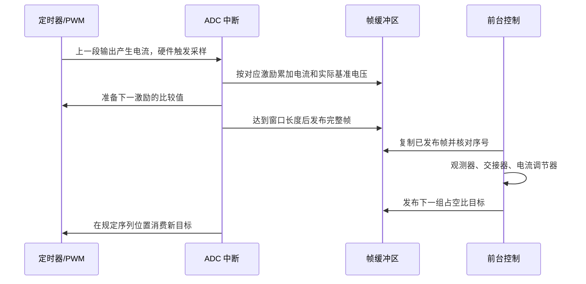

# FOC 实现讲义：从小数计算到按时执行

这本配套讲义接着 [FOC 入门教材](foc-algorithms.md) 往下讲：纸面上已经会算的公式，怎样放进没有浮点单元、只有 4 KiB RAM 的单片机，并且每一轮都按时算完。

建议先读主教材第 1～9 章，再读本篇。先把“小数如何表示、误差如何累计”弄懂，再看查表和调度；否则容易把优化理解成记忆一堆位移和常数。

| 阅读阶段 | 要解决的问题 |
| --- | --- |
| 第 1～2 节 | 为什么换成整数，怎样保持原公式的物理含义 |
| 第 3～5 节 | 哪些计算值得查表，怎样减少除法并保留小数效果 |
| 第 6～7 节 | 算法何时运行，电压与电流应该对应哪个时刻 |
| 第 8～9 节 | RAM 怎样分配，怎样证明优化没有算错或错过时限 |

代码依据为 `97265ca` 后的实现。文中的历史计时会单独注明版本背景；动态指令数、板上时钟周期和控制帧是否按时完成，分别是不同的证据。

## 1. 为什么主要使用定点计算

本板配置为 48 MHz Cortex-M0+，Flash 64 KiB、RAM 4 KiB，没有硬件浮点单元。既有板上测试还确认，这块 CW32L010 的乘法器需要 32 个周期，不能按某些 Cortex-M0+ 实现的一周期乘法器估算。

因此，优化目标包含三层：

1. 避免控制热路径的软件浮点、通用三角函数和不必要的 64 位运算。
2. 即使用整数，也尽量减少除法和代价较高的乘法。
3. 降低单帧最坏计算峰值，保证控制按时更新，而不只是降低平均执行时间。

工程没有依赖 CMSIS-DSP 来完成这些核心运算。CMSIS-Core 提供寄存器和内核访问接口；当前变换、查表、根号与观测器均为项目自己的整数实现。是否使用现成库应由实际指令、精度和存储代价决定。

## 2. 工程单位与 Q 格式

### 2.1 先统一尺度，再讨论整数算式

#### 先做一个没有缩写的例子

单片机当然可以保存整数 866，但我们真正想表达的可能是 0.866。只要约定“这个整数还要除以 1000”，整数也能保存小数含义。

Q 格式做的是同一件事，只是把比例改成 2 的幂。例如 Q14 约定除以 $2^{14}=16384$：

| 想表达的数 | 存进整数的值 | 还原方法 |
| --- | --- | --- |
| 1 | 16384 | $16384/16384=1$ |
| 0.5 | 8192 | $8192/16384=0.5$ |
| −0.5 | −8192 | $-8192/16384=-0.5$ |
| 约 0.866025 | 14189 | $14189/16384\approx0.866028$ |

整数 14189 本身不会告诉编译器“我代表余弦”。**比例是程序员必须保持的一份约定**。同样的 8192，在普通计数、Q14 比例和角度 Q8 中，含义完全不同。

#### 为什么乘完以后要再除一次比例

若 $X=16384x$、$Y=16384y$，那么 $XY=16384^2xy$。如果结果仍想用 Q14 存，就要除以一次 16384。

例如 $0.5\times0.5=0.25$，整数计算为：

$$
\frac{8192\times8192}{16384}=4096,
$$

而 $4096/16384=0.25$。忘记缩放就会得到大 16384 倍的结果；多除一次则会把结果几乎消成零。

#### 电流并不需要一起改成 Q14

电流可以直接用 mA 表示。500 表示 500 mA，乘以 Q14 的正弦后，除以 16384，结果仍然是 mA。先跟踪单位，再跟踪小数位，就不容易混乱。

若用 Qn 表示一个实数 $x$，存储整数 $X\approx x2^n$。乘法时要显式恢复尺度：

$$
X_{Qm}Y_{Qn}\longrightarrow (XY)_{Q(m+n)}.
$$

但本项目并非所有量都用统一的 Q15。电流、电压直接采用工程整数单位，只有需要小数的状态和比例采用 Q 格式。

| 量 | 当前表示 | 使用时要注意 |
| --- | --- | --- |
| 电流、电压 | mA、mV，主要为 `int32_t` | 相乘前核对范围和单位 |
| 位置、机械速度、机械加速度 | mrad、mrad/s、mrad/s² | 与电角增量分开 |
| 一圈电角度 | 16384 计数 | 加减后按一圈回绕 |
| 正弦、余弦 | Q14，1 对应 16384 | 不能按 Q15 除以 32768 |
| HFI/SMO 角状态 | 电角度计数 Q8 | 保留亚计数角度 |
| HFI/SMO 速度状态 | 每次更新的电角增量 Q8 | 采样周期改变时必须换算 |
| HFI 解调响应 | ADC 平均计数乘 8，即 Q3 | 不等同于 mA |
| SMO 电流状态 | mA Q8 | 防止小电流增量被逐次截断 |
| SMO 衰减系数 | Q16 | 模型系数在配置时预计算 |
| 弱磁积分状态 | mA Q6 | 每次小电压误差仍能累计 |
| HFI PWM 目标 | 定时器比较值 Q8 | 量化时保留低 8 位余数 |

例如 Park 变换中的一项为：

$$
i_d[\mathrm{mA}]
=\frac{i_\alpha[\mathrm{mA}]C_{Q14}+i_\beta[\mathrm{mA}]S_{Q14}}{16384}.
$$

当前声明的是 `int32_t` 并不意味着可以输入任意 `int32_t` 电流：中间的乘积与加法也必须在范围内。实现面向现有电压、电流和增益约束，不能脱离约束单独推断每个函数对任意输入都安全。

#### 把主教材的 30° 算例换成整数

先暂时忽略角度计数量化，用理论 30° 四舍五入得到的 $S=8192$、$C=14189$。输入电流是 −500、1000、−500 mA。

1. Clarke 得到 $i_\alpha=-500$ mA，$i_\beta$ 截断后为 866 mA。
2. d 轴分子为 $-500\times14189+866\times8192=-228$。
3. 除以 16384，按 C 语言朝零截断，得到 0 mA。
4. q 轴得到约 1000 mA；整数截断可能少一个计数。

这与实数计算的 $i_d=0,i_q=1$ A 一致到整数分辨率。真实代码的 30° 还会先落到最近的电角度计数，所以实际正余弦也存在角度量化。两类误差要分别理解。

**小结：定点没有改变 FOC 的数学目标，只是约定每个整数代表什么，以及允许怎样的量化误差。**

### 2.2 角度增量与机械速度的换算

设角速度状态 $D$ 为“一次更新的电角度计数 Q8”，则：

$$
\omega_m[\mathrm{mrad/s}]
=\frac{D}{256}\frac{2\pi}{16384}\frac{1000}{pT_s}.
$$

本项目 $p=7$：1.6 ms 时近似为 `D * 107 / 800`，200 µs 时为 `D * 107 / 100`。同一物理速度切换到八倍更新率，单步角增量就要缩小到八分之一。

`Smo_SetSamplePeriod()` 保持这种物理一致性，并重新安排角状态以保留交接器使用的一步预测角。只修改一个 `sample_us` 字段而不换算速度状态，会造成角度推进突然改变。

### 2.3 有符号截断、移位与余数

C 的有符号整数除法朝零截断；负数右移在本工具链中采用算术右移。二者对负的小数并不总是相同。因此，优化时不能把所有 `/ 2^n` 都当作完全等价的 `>> n`。

位置累计、加速度斜坡、PWM 量化保留了各自的余数。以加速度参考为例：若每帧应增加 0.4 mrad/s，直接逐帧取整会永远增加 0；累计小数后可以用多个离散整数步逼近期望平均变化率。

你可以在纸上试五轮：理想累计值依次为 0.4、0.8、1.2、1.6、2.0；若保留余数，整数输出可以依次前进 0、0、1、0、1，共前进 2。每轮都独立丢弃小数，则五轮之后仍为 0。这是“保留余数”比单次舍入方式更重要的一个例子。

## 3. 用 Flash 查表换取确定的计算代价

四张表都位于 [`foc_tables.h`](../../firmware/Control/Src/foc_tables.h)，以 `const` 放入 Flash 的 `.rodata`。它们不会在启动时整体复制到 RAM。

| 表 | 项数和类型 | 字节 | 用途 |
| --- | --- | --- | --- |
| `sine_quarter` | 4097 × uint16 | 8194 | 四分之一周期正弦 |
| `atan_octant` | 1025 × uint16 | 2050 | 八分圆内反正切 |
| `atan_reciprocal` | 512 × uint16 | 1024 | 归一化分母倒数 |
| `sqrt_seed` | 768 × uint32 | 3072 | 平方根上界初值 |
| 合计 | | 14340 | 约 14 KiB Flash |

### 3.1 正余弦：四分之一圆与象限恢复

先问一个简单问题：如果已经知道 30° 的正弦，是否还需要重新计算 150° 的正弦？不需要，因为二者相等。类似地，余弦可以用互余关系得到，其他象限可以改符号。查表正是在利用这些对称关系。

一圈 16384 计数，一个象限为 4096。表包含两个端点，通过偏移直接取得第一象限正弦；余弦通过互余索引取得，再根据象限交换与改变符号。

这样每个可表示角度都有表项，无需在相邻角度间插值。所得值与生成脚本四舍五入后的 Q14 值一致；它仍有 Q14 量化误差，并不是无限精度三角函数。

### 3.2 atan2：先缩到一个八分圆

对于输入 $(y,x)$，先取绝对值并令：

$$
M=\max(|x|,|y|),\quad m=\min(|x|,|y|),\quad r=m/M\in[0,1].
$$

只查 $\arctan r\in[0,\pi/4]$，随后恢复轴交换和象限。关键优化是避免每次用软件除法求 $m/M$：

1. 用前导零计数共同归一化分子、分母。
2. 归一化分母落在 $[32768,65535]$。
3. 用 512 个区间中点的 Q31 倒数求近似比例。
4. 得到 $0\ldots1024$ 的比例索引，再查反正切。

HFI 和 SMO 共用此实现。现有回归向量的最大角误差为 2 个电角计数，约 $0.044^\circ$ 电角度；这是回归覆盖结果，不应扩写成对所有任意 32 位向量的形式化误差证明。零向量按接口约定返回零，其物理意义上的角度仍然不可观测。

### 3.3 精确整数根号

`FOC_Sqrt()` 求 $\lfloor\sqrt n\rfloor$：

1. 用偶数位归一化保持平方根缩放关系。
2. 查表得到上侧初值。
3. 做一次整数 Newton 更新 $r\leftarrow(r+n/r)/2$。
4. 用平方比较修正可能的一个计数超出。

SMO 的反电动势幅值需要稳定的幅值判定，因此使用精确结果。此路径仍有一次整数除法；“查表开根号”不等于完全没有除法。

### 3.4 保守平方根下界

电流、电压剩余预算需要满足 $q\leq\sqrt{B}$。若近似值略小，只减少一点可用预算；若略大，就可能违反圆形约束。

`FOC_SqrtLowerBound()` 复用相同种子表，以前一区间上界减一构成下界，避免 Newton 除法，不新增表和 RAM。误差约在 0.2% 加一个计数以内，方向为保守。无感电流预算与 q 轴电压预算使用它；不会把它用于所有需要精确幅值的计算。

### 3.5 表格的可复现生成

```powershell
uv run --script tools/generate_foc_tables.py --check
```

生成脚本使用主机高精度数学函数，MCU 只存放结果。若要改变表分辨率，应同步检查索引、误差、Flash 占用与执行时间。

## 4. 整数热路径中的除法、乘法与系数准备

### 4.1 用有界倒数乘法替代常量除法

形式上，$n/d$ 可近似为 $(nK)\gg q$，其中 $K\approx2^q/d$。但需要同时证明：乘积不溢出，商误差足够小，而且符号和舍入符合原语义。

项目中的例子包括：

- `per_thousand()`：PI 常用范围内用拆分、倒数乘法与一次商修正除以 1000；更大的合法范围仍走通用除法。
- `response_divide()`：按 38、37、152 等已知采样数量求响应平均值，使用 Q18 倒数并修正一个计数。
- 加速度参考：有界的除以 5000，用余数累计与商修正保持两种采样率下一致。
- PWM：12 V 常用配置有专门的比例路径，其他母线在主循环更新时预计算换算增益。

这不是把任意除法机械改写成某个魔数。每个快捷路径都有自己的输入范围和舍入规则。

### 4.2 避免热路径的 64 位乘积

例如 SMO 电流状态为 Q8，衰减系数为 Q16。直接相乘容易需要 64 位中间值，代码先拆成整数和小数：

$$
I_{Q8}=256I_{int}+I_{frac},\qquad 0\leq I_{frac}<256,
$$

$$
I_{Q8}\,a_{Q16}
=256I_{int}a_{Q16}+I_{frac}a_{Q16}.
$$

分别缩放再合并，在受限电流范围内保持 32 位计算。速度到场角增量的常量乘积也使用类似拆分。

配置阶段则允许较贵的 64 位计算。`Smo_Prepare()` 计算衰减、输入增益和隐式边界层系数；母线更新准备 PWM 比例因子。它们不应被搬进每帧执行的 `current_step()`。

### 4.3 编译选项必须匹配本板

[`CMakeLists.txt`](../../firmware/CMakeLists.txt) 使用 `-mtune=cortex-m0plus.small-multiply`，让编译器考虑慢乘法器。控制模块与应用入口为 `-O2`，ADC 驱动为 `-O3`，普通 Release 基础选项为 `-Os`。

因此，Debug 构建中的关键文件仍有单独优化，不能把整个 Debug 固件当成统一 `-O0`。提高优化级别后也要检查实际汇编和最坏路径；更多指令并不一定更慢，单条慢乘法也不一定优于几条移位加法。

## 5. PWM 分辨率与量化余数反馈

在 48 MHz 定时器时钟下，中心对齐普通 PWM 的 ARR 约 1200，频率约 20 kHz；HFI 使用 ARR 约 240，频率约 100 kHz。开关频率提高，整数比较值分辨率会降低。

HFI 目标使用 Q8 比较值，先保持小数占空比，再在中断中量化：

$$
A_k=D_{Q8,k}+r_{k-1},\qquad
D_{timer,k}=\left\lfloor\frac{A_k}{256}\right\rfloor,\qquad
r_k=A_k\bmod256.
$$

未发生限幅时，对多次输出求和，小数误差会留在余数里，而不是每周期都被丢弃。例如目标为 100.25 个计数，可以在四次更新中平均得到 100.25，即使单次只能写整数比较值。

它提升的是时间平均分辨率，不改变单个 PWM 周期的计数器分辨率，也不保证量化噪声完全消失。接近限幅边界时也不能继续套用未限幅的平均误差结论。

连续注入还把基波目标与注入差量分离。基波目标在每个完整注入序列起点按 $b\leftarrow(7b+b^*)/8$ 平滑，注入差量继续按序列切换，降低前台低速更新带来的阶跃调制。SMO 输入电压则从实际执行的基准比较值重建，而不是直接拿尚未实现的前台目标。

## 6. 控制时序与多速率调度

### 6.1 三个阶段的频率表

下表都是标称值，精确时刻以硬件计时和 trace 为准。

| 阶段 | PWM / ADC EOS | 注入序列重复率 | 算法与电流环更新 | 外环 | 诊断样本发布 |
| --- | --- | --- | --- | --- | --- |
| 普通有感 | 约 20 kHz / 20 kHz | 无 | 1 kHz | 位置、速度 200 Hz | 1 kHz |
| HFI 辅助低速及慢 SMO | 约 100 kHz / 100 kHz | 四状态序列 25 kHz | 625 Hz，即 1.6 ms | 无感速度 PI 接管后 125 Hz | 500 Hz |
| 快 SMO | 约 20 kHz / 20 kHz | 无 | 5 kHz，即 200 µs | 速度 PI、弱磁各 125 Hz | 500 Hz |

100 kHz 是 PWM 与采样事件率；四个 10 µs 状态组成 40 µs 注入序列，所以序列基频为 25 kHz；40 个序列组成 1.6 ms 解调帧，所以估角更新率为 625 Hz。把其中某一个频率当成全部控制带宽，会误判性能。

**时间预算算例：**48 MHz 表示每秒约 4800 万个核心时钟周期。200 µs 控制帧包含 $48\times200=9600$ 个周期，但中间还要执行 ADC 中断；100 kHz ADC 的两次事件间隔只有 10 µs，即 480 个周期。一个平均耗时不大的函数，如果偶尔与多个外环计算挤在同一帧，仍可能错过期限。

可以把这一节想成安排课表：PWM 是最密集的执行节拍，ADC 在规定位置观察结果，控制器隔若干拍汇总并调整，速度环则更慢。它们不必同频，但必须知道彼此对应哪一段时间。

普通有感模式每 20 个 ADC 转换发布一组当前采样值，并非自动将这 20 个转换取平均。HFI 采用分状态平均，快 SMO 则每四次转换取电流、电压平均。三者的测量滤波和延迟不同。

### 6.2 测量时刻与输出时刻



SMO 需要解释的是“什么电压导致了这组电流”。快路径在四次 ADC 中累加执行中的基准占空比，低速路径对保留的序列窗口做电压抽样重建；两种路径都按配置母线缩放。

静止坐标中，可以由去共模后的占空比重建：

$$
v_\alpha=\frac{V_{dc}}3(2d_a-d_b-d_c),\qquad
v_\beta=\frac{V_{dc}}{\sqrt3}(d_b-d_c).
$$

因此母线配置错误不仅影响限幅，还直接影响观测器电压模型。当前没有端电压实测，这种重建仍包含功率器件压降、死区与 PWM 量化等误差。

电流 Park 变换使用已完成窗口对应的控制角；下一段逆 Park 使用向前推进的角。SMO 输出再预测一个更新周期用于控制。这是降低时序错位的措施，不代表整个平均窗口已被精确折算成一个无延迟的瞬时采样。

### 6.3 为什么优先处理控制帧

ADC 中断负责必需的采样、限值检查、累加和序列推进；较重的变换、观测和 PI 留在主循环。主循环先消费无感控制帧，再安排编码器诊断和 RTT。

快 SMO 下，编码器仅作对照，不作为无感反馈。I²C 用 `BeginRead/PollAngle` 状态机推进，等待通信期间主循环仍能处理 200 µs 控制帧。I²C 总线为 1 MHz，但降低阻塞时间靠的是调度方式，不能只靠提高 SCL。

### 6.4 双缓冲与序号为什么都需要

- HFI/SMO 累加区用双缓冲。中断切换写入区后再发布序号，前台复制完整的上一块，序号改变则重读。
- PWM 目标也双缓冲，先填完一组，再发布指针，避免中断看到半组新值、半组旧值。
- 普通诊断用八项队列，溢出保留最近样本；丢失通过序号差记录。
- 无感控制帧没有无限积压队列。前台来不及消费时可能跳过旧帧，`hfi_missed_frames` 记录跳帧数量。

`volatile` 用于共享状态可见性；`__DMB()` 保证先写内容再发布；短临界区保护需要整体切换的多字段。三者职责不同，单独加一个 `volatile` 不能自动解决全部发布顺序与一致性问题。

### 6.5 快慢采样率切换是状态迁移

从 1.6 ms 切到 200 µs，需要一起处理：

1. SMO 速度增量换算、电流模型系数准备和预测角连续性。
2. PWM 周期与归一化占空比转换。
3. ADC 平均窗口、累加区、分频和在途转换。
4. 电流 PI 的积分时间尺度与电流斜坡余数。
5. 诊断采样周期以及暂态相位偏置。

当前进入快路径前，趁旧路径仍有较长周期准备较贵系数；返回慢路径时先恢复较长采样周期，再准备慢路径系数。切换后有 40 ms 相位适应窗口，将合格且有界的相位差吸收到交接偏置，再逐渐消除。

低速启动延迟到正 Id 退出后再切快环，也是对观测模型与暂态的一项处理。它和“到某个固定转速就从 HFI 切 SMO”不是同一条判断。

### 6.6 分散外环峰值，而不只优化平均值

5 kHz 快环每 40 帧更新一次速度 PI，即 8 ms。弱磁环也每 40 帧更新，但放在相隔 20 帧的位置；电流预算在相应后续帧计算。

```text
40 帧循环：
  帧 0       电流预算
  帧 19      弱磁电压幅值、目标积分
  帧 20      电流预算
  帧 39      速度 PI
  每一帧     当前电流调节、必要观测和输出
```

慢路径中，相应循环为五帧，保持外环约 8 ms 的时间尺度。这样减少根号、预算和速度 PI 在同一帧叠加的峰值。启动正 Id 退出和 Iq 斜坡也按时间尺度换算，避免切换更新率后物理斜率成倍改变。

## 7. 延迟、混叠与丢拍

### 7.1 更新率应与电气速度比较

每个电周的更新数为：

$$
N_e=\frac{2\pi f_s}{p|\omega_m|}.
$$

在 400 rad/s、七极对下：625 Hz 只有约 1.40 次/电周，5 kHz 约 11.22 次/电周。前者已不足以无歧义跟踪普通电角运动；HFI 的二倍角还需要考虑 $2\omega_e$，要求更严。

按理想奈奎斯特边界，二倍角观测要求 $|\omega_m|<\pi/(2pT_s)$。1.6 ms、七极对时约 140 rad/s；实际需要更多裕量，当前启动参考限制为 100 rad/s，之后转入快路径再放开更高目标。理论混叠边界不是建议工作带宽。

### 7.2 一阶滤波与平均窗口各自带来延迟

SMO 的 `filter_shift=3` 对应离散极点 0.875。等效连续极点频率约为：

$$
f_p=\frac{-\ln(0.875)}{2\pi T_s}.
$$

200 µs 时约 106 Hz，1.6 ms 时约 13.3 Hz。即使相同整数滤波参数，物理滤波频率也不同。精确相位补偿能修正该离散滤波器的相位，但滤波导致的幅值衰减仍会影响反电动势阈值。

四点平均还带有自己的群延迟。若输入近似均匀采样的低频信号，长度 $N$ 的滑动平均延迟约为 $(N-1)T_{ADC}/2$。HFI 则是分状态、丢弃起始序列并带漂移修正的聚合，不能直接把它当成一个无条件等效的普通四点平均。

### 7.3 丢拍为什么比一个较高噪声谱峰更严重

固定周期离散观测器假定相邻更新间隔近似恒定。跳过一帧后，如果仍只推进一个固定 $T_s$，角度预测、电流积分和参考轨迹会与物理时间错开。后续帧可能重新拉回，但会增加相位和电流扰动。

目前跳帧会被记录，代码并未把所有模块都改成按任意不规则时间间隔自适应积分。因此，降低平均负载和检查最坏帧开销都很重要。

诊断丢样和控制丢拍分别计数。无感阶段诊断是 500 Hz；其超时阈值为四个实际诊断周期，控制帧另有看门逻辑。不能因为遥测暂时慢了一次，就直接断言电流环停止了更新；也不能因为 RTT 没丢记录，就认为控制一定没有跳帧。

## 8. RAM 与数据搬运

### 8.1 互斥工作区与栈预算

有限脉冲测量与连续 HFI/SMO 互斥，复用 `measurement` 联合体。每种模式开始前清理所属成员，避免旧的累加和序号污染新模式。这个优化依赖明确的所有权；不能在两个算法同时需要各自历史状态时继续强行复用。

当前链接器为 MSP 栈预留 1536 字节，RAM 总量为 4096 字节。`97265ca` 对应的现有 Release map 中：`.data` 为 1216 字节，`.bss` 为 1236 字节；加对齐和预留栈共约 3992 字节。这里 `.data` 还包含启动时搬到 RAM 的执行代码。

剩余约 104 字节是超出已预留栈后的链接空间，不是“运行时只有 104 字节栈”。同样，链接成功也不证明 1536 字节栈在所有调用和中断嵌套下都足够；实际栈峰值需要单独测量。

### 8.2 只把值得放进 RAM 的代码放进去

ADC IRQ、连续注入采样热路径和关键 PWM 写入函数使用 `.RamFunc`。这有助于缩短高频路径并减少 Flash 访问代价，但会消耗稀缺 RAM。控制器和四张大表没有全部搬到 RAM。

HFI ADC 热路径还刻意减少乘法，改为加减、索引和移位；较重的单位换算、均值与观测器计算留在前台。

### 8.3 二进制 RTT 与对齐拷贝

状态和高速 trace 都是固定二进制结构，固件不做浮点格式化，也不保留 `-u_printf_float`。人类可读显示和单位转换由主机完成。

RTT 写入采用对齐字拷贝，环尾分段处理，非对齐输入或尾部字节才逐字节处理。先完成整帧内容，再发布写指针；空间不足丢弃整帧。这既减少固件搬运开销，也避免主机把半帧当成完整状态。

## 9. 如何判断优化确实有效

### 9.1 数值、软件执行与实机时序分别验证

| 检查层 | 能回答的问题 | 不能单独证明的内容 |
| --- | --- | --- |
| 表生成与数学回归 | 量化、象限、范围、预算方向是否正确 | 真实 ADC 噪声与电机稳定性 |
| Unicorn 执行实际 ARM ELF | 编译后算法、状态迁移和寄存器流程是否符合测试输入 | 本板逐周期性能、模拟电路与磁路响应 |
| 动态指令统计 | 某条软件路径执行了多少指令 | 慢乘法、Flash 等待和中断抢占后的真实耗时 |
| 板上核心时钟计时 | 同工况函数的实际周期代价 | 完整运行时的最坏调度峰值 |
| 实机控制 trace | 帧率、跳帧、交接和电流/速度行为 | 未覆盖负载、母线和电机条件下的表现 |

本项目离线执行器是 Unicorn 加项目寄存器模型，不是周期精确的 CW32L010 或 QEMU 外设模型。连续电机模型回归可检查离散观测误差，但不能代替电机硬件，也不能据此证明某个高转速实物一定达到。

### 9.2 已有计时记录应怎样使用

2026-11-06 的查表优化对照在同一板、48 MHz、屏蔽中断条件下计时，每项重复 15 次并扣除空测试段。它记录的是当时函数版本：

| 函数 | 优化前 | 优化后 |
| --- | --- | --- |
| 正余弦，角度计数 1000 | 223 周期 | 45 周期 |
| HFI 更新 | 591 周期 | 555 周期 |
| SMO 更新，反电动势可见 | 1797 周期 | 1592 周期 |

这些数据说明查表与整数路径有收益，但后续 SMO 已增加梯形积分等逻辑，不能把历史周期直接作为当前完整 200 µs 控制帧的最坏耗时。原始记录位置见 [调试文档](../debugging.md)。

### 9.3 修改后的验证入口

算法或执行路径改变后，在仓库根目录运行：

```powershell
uv run --script tools/debug.py verify
```

已有对应固件时用 `--no-build`。数值回归覆盖完整角度表、反正切和根号输入、SMO 连续 R/L 模型、HFI/SMO 交接、反转、弱磁预算及采样率转换。真实时序验证还要看实机帧消费率与丢拍计数。

当前文档整理没有修改固件，也没有启动电机测试。这里描述的是已实现的措施及其验证边界，不新增性能承诺。

### 9.4 教材插图的生成

坐标图、三相/dq 波形和 HFI 理想响应图由主机脚本生成：

```powershell
uv run --script tools/docs/generate_foc_figures.py
```

SVG 保存于 `docs/firmware/assets/foc/`，预览 PNG 保存于忽略的 `tools/build/docs-figures/`。插图使用理想模型和明确的教学参数，不代表新做了一次电机实测。
